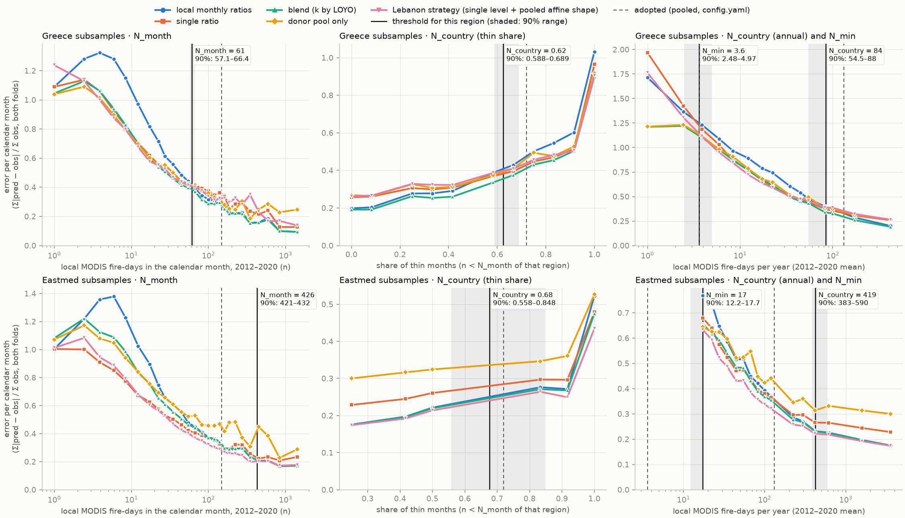

# Data-thinness thresholds (derived, 2026-11-14)

Derived from a cell-subsampling experiment instead of being hand-set. Code: `tools/thresholds_experiment.py` (runs) and `tools/thresholds_analysis.py` (thresholds, this report, `thresholds.png`). Raw results: `docs/reports/thresholds_data/`.

## Experiment

- Greece and EastMed. Each run keeps 100, 50, 20, 10, 5 and 2 % of the region's cells (plus 1 and 0.5 % to locate N_min), with 200 repetitions per fraction. Seed 20261114; each run's seed is recorded.
- Five strategies are fitted per run: local monthly ratios; single ratio; blend (k by leave-one-year-out on the fit years); donor pool only; and the Lebanon strategy (annual level from single, monthly shape from the affine blend with the donor pool).
- Donors are disjoint from the subsampled region: `eastmed_pool` for Greece (Lebanon's pool), and all of Greece for EastMed.
- Fitting inputs are the pipeline's: usable dates only, persistent fire-days excluded.
- Each run is scored on the forward (fit 2012–16, test 2017–20) and reverse hold-out folds, on region monthly totals, and on the 2012 continuity check (step index and band, as in validate).
- At 100 % the harness reproduces validate's Greece hold-out exactly (local 0.188/0.152, single 0.265/0.221, blend 0.186/0.147, Lebanon strategy 0.315/0.158).

## Definitions

- **n** = local MODIS fire-days in a calendar month, summed over 2012–2020. The annual total is Σn / 9.
- **N_month:** n above which local monthly ratios are no worse (within 0.01) than the best fixed-borrowing alternative (single, donor, Lebanon strategy) for that month. Blend contains local and converges to it, so it is reported separately.
- **N_country:** the share of thin months (n < N_month) at or above which the Lebanon strategy beats local by more than 0.01 WAPE. It is also given as an annual total.
- **N_min:** the annual total below which the donor pool alone beats every strategy that uses local data by more than 0.01.
- **Estimation:** each crossing is read from a monotone (isotonic, count-weighted) fit of the challenger's advantage across bins, interpolated between bin centres. Ties go to the simpler choice. The 90 % range comes from a 1,000-draw cluster bootstrap of runs within region × fraction.

## Results

| threshold | Greece | EastMed | pooled | δ = 0 (Greece / EastMed / pooled) | **adopted** |
|---|---|---|---|---|---|
| N_month | 61 [57–66] | 426 [421–432] | 149 [146–156] | 65 / 777 / 160 | **149** |
| N_country | 0.62 [0.59–0.69] | 0.68 [0.56–0.85] | 0.72 [0.71–0.77] | 0.58 / 0.33 / 0.75 | **0.72** |
| N_country_annual | 84 [54–88] | 419 [383–590] | 132 [129–149] | 90 / — / 139 | **132** |
| N_min_annual | 3.6 [2.5–5.0] | 17 [12–18] | 3.6 [2.4–4.9] | 3.8 / 17 / 3.8 | **3.6** |

**The threshold depends on the fire regime.** N_month is 61 in Greece and 426 in EastMed:
- **Greece:** ratio-type fire. Local monthly ratios win as soon as a month has about 60 MODIS fire-days.
- **EastMed:** much of the activity is small agricultural fire that MODIS doesn't see. VIIRS fire-days in cell-days without MODIS make an affine (intercept) shape better than local ratios up to about n = 400. EastMed is also sensitive to the tie rule (δ = 0 moves its N_month to about 780); Greece is not.
- **Bootstrap ranges:** narrow, because 200 repetitions pin each region's curve down. The uncertainty that matters is between regimes, not within one.

**Adopted: the pooled estimates (`pooled`, decided 2026-11-14), a conservative choice for new countries.**
- A new country's fire regime is unknown until it is calibrated, so the rule borrows unless a month has enough data for local ratios to win under both regimes.
- Pooled N_month (149) is about 2.5 times Greece's (61). Ratio-type countries may therefore be sent to the Lebanon strategy (pooled level, affine shape) somewhat earlier than they need to be.
- That costs little: in the Greece subsamples between n = 60 and 150, the Lebanon strategy's per-month error is within 0.01–0.03 of local. The reverse mistake costs more: applying Greece's threshold to an EastMed-like country would leave months on local ratios that lose by 0.05–0.08 per month (n = 60–400).

## Check against Lebanon and k = 20

| month | Jan | Feb | Mar | Apr | May | Jun | Jul | Aug | Sep | Oct | Nov | Dec |
|---|---|---|---|---|---|---|---|---|---|---|---|---|
| Lebanon n | 3 | 2 | 3 | 4 | 5 | 27 | 56 | 66 | 116 | 133 | 53 | 10 |
| thin at N_month = 61 (greece) | thin | thin | thin | thin | thin | thin | thin |  |  |  | thin | thin |
| thin at N_month = 149 (pooled) | thin | thin | thin | thin | thin | thin | thin | thin | thin | thin | thin | thin |

Lebanon's months, in order of richness: Oct 133, Sep 116, Aug 66, Jul 56, Nov 53, Jun 27, Dec 10, then Jan–May 2–5.
- **Under the adopted (pooled) threshold, all 12 months are thin**, so Lebanon is a thin country (share 1.00 ≥ 0.72) and the Lebanon strategy applies, as in v1.0-data. Aug–Oct are the richest months.
- **This replaces the earlier reading** (Dec–May need donor borrowing, Jun–Nov have enough local signal). Dec–May are confirmed thin at every threshold. Jun–Nov are not "enough": even Greece's threshold (61) leaves only Aug–Oct rich.
- **No Lebanon value changes:** the strategy and factors are those of v1.0-data.
- **k = 20:**
  - Blend weight on local is w = n / (n + k). With k = 20, w is 0.75 at Greece's N_month (61) and 0.88 at the pooled 149, so local dominates by the time the thresholds say it should.
  - The k chosen by leave-one-year-out in the subsamples centres on 10–50 for regions of Lebanon's size (annual 20–110), with k ≤ 20 in 35–65 % of runs. It falls to 5 or 0 as n grows.
  - Blend's advantage over local drops below 0.01 at n ≈ 175 in Greece and ≈ 60 in EastMed. **k = 20 is consistent with the data.**

## Rule (for add-country) and regression against v1.0-data

Rule: annual < N_min → `donor`; else thin share ≥ N_country → Lebanon strategy; else `local`.

v1.0-data strategies are read from the tag's config.yaml.

| region | annual n | thin months (adopted N_month) | thin share | rule picks | v1.0-data | same? |
|---|---|---|---|---|---|---|
| lebanon | 53.1 | Jan, Feb, Mar, Apr, May, Jun, Jul, Aug, Sep, Oct, Nov, Dec | 1.00 | lebanon | lebanon | yes |
| greece | 865.4 | May | 0.08 | local | local | yes |
| eastmed | 5355.4 | none | 0.00 | local | local | yes |

With greece-only thresholds the picks are: lebanon lebanon, greece local, eastmed local (all as v1.0-data).

With eastmed-only thresholds the picks are: lebanon lebanon, greece local, eastmed local (all as v1.0-data).

## Binned results (pooled)

Error per calendar month by n (ratio of sums over both folds):

| n from | runs×months | local | single | blend | donor | lebanon |
|---|---|---|---|---|---|---|
| 0 | 2429 | 1.068 | 1.068 | 1.053 | 1.047 | 1.181 |
| 2 | 1049 | 1.261 | 1.094 | 1.159 | 1.118 | 1.114 |
| 3 | 1741 | 1.334 | 1.011 | 1.083 | 1.035 | 0.983 |
| 5 | 1333 | 1.316 | 0.898 | 0.993 | 0.951 | 0.879 |
| 7 | 1486 | 1.180 | 0.805 | 0.887 | 0.849 | 0.796 |
| 10 | 1871 | 0.990 | 0.692 | 0.749 | 0.749 | 0.677 |
| 15 | 1427 | 0.846 | 0.622 | 0.657 | 0.660 | 0.587 |
| 20 | 1215 | 0.728 | 0.565 | 0.585 | 0.609 | 0.557 |
| 25 | 1008 | 0.632 | 0.540 | 0.556 | 0.603 | 0.526 |
| 30 | 1644 | 0.582 | 0.502 | 0.506 | 0.552 | 0.468 |
| 40 | 1522 | 0.514 | 0.451 | 0.455 | 0.485 | 0.431 |
| 50 | 1056 | 0.461 | 0.425 | 0.433 | 0.473 | 0.409 |
| 60 | 1209 | 0.425 | 0.408 | 0.413 | 0.481 | 0.382 |
| 75 | 1204 | 0.378 | 0.391 | 0.361 | 0.420 | 0.363 |
| 90 | 1535 | 0.342 | 0.371 | 0.324 | 0.402 | 0.330 |
| 110 | 1025 | 0.339 | 0.351 | 0.329 | 0.401 | 0.307 |
| 130 | 725 | 0.330 | 0.342 | 0.325 | 0.409 | 0.303 |
| 150 | 663 | 0.286 | 0.309 | 0.282 | 0.371 | 0.288 |
| 175 | 605 | 0.256 | 0.273 | 0.256 | 0.371 | 0.278 |
| 200 | 1297 | 0.253 | 0.302 | 0.253 | 0.351 | 0.296 |
| 250 | 697 | 0.289 | 0.317 | 0.287 | 0.365 | 0.248 |
| 300 | 1136 | 0.219 | 0.251 | 0.217 | 0.284 | 0.229 |
| 400 | 1028 | 0.187 | 0.220 | 0.189 | 0.368 | 0.215 |
| 500 | 1292 | 0.203 | 0.235 | 0.200 | 0.362 | 0.195 |
| 700 | 560 | 0.166 | 0.203 | 0.163 | 0.227 | 0.172 |
| 1000 | 2867 | 0.169 | 0.231 | 0.168 | 0.288 | 0.176 |

Region hold-out WAPE (mean of both folds) and continuity pass rate, by annual n:

| annual n from | runs | local | single | blend | donor | lebanon | continuity pass (local / Lebanon / donor) |
|---|---|---|---|---|---|---|---|
| 0 | 21 | 1.715 | 1.970 | 1.211 | 1.214 | 1.763 | 95% / 81% / 67% |
| 2 | 51 | 1.365 | 1.424 | 1.221 | 1.232 | 1.305 | 100% / 96% / 78% |
| 3 | 79 | 1.231 | 1.188 | 1.102 | 1.118 | 1.116 | 100% / 99% / 85% |
| 5 | 106 | 1.090 | 1.030 | 0.979 | 0.981 | 0.950 | 96% / 99% / 88% |
| 7 | 97 | 0.965 | 0.867 | 0.873 | 0.905 | 0.841 | 100% / 100% / 78% |
| 10 | 117 | 0.892 | 0.767 | 0.752 | 0.764 | 0.716 | 95% / 98% / 77% |
| 15 | 131 | 0.783 | 0.670 | 0.666 | 0.671 | 0.636 | 96% / 99% / 79% |
| 20 | 89 | 0.739 | 0.620 | 0.619 | 0.635 | 0.592 | 94% / 94% / 79% |
| 25 | 50 | 0.658 | 0.580 | 0.593 | 0.632 | 0.532 | 92% / 100% / 72% |
| 30 | 138 | 0.595 | 0.520 | 0.518 | 0.559 | 0.493 | 91% / 93% / 77% |
| 40 | 171 | 0.531 | 0.469 | 0.466 | 0.494 | 0.457 | 96% / 97% / 78% |
| 50 | 92 | 0.503 | 0.464 | 0.465 | 0.514 | 0.441 | 95% / 98% / 66% |
| 60 | 68 | 0.447 | 0.429 | 0.418 | 0.511 | 0.394 | 94% / 97% / 75% |
| 75 | 154 | 0.404 | 0.379 | 0.352 | 0.394 | 0.380 | 98% / 97% / 73% |
| 90 | 151 | 0.385 | 0.371 | 0.352 | 0.404 | 0.358 | 95% / 94% / 74% |
| 110 | 70 | 0.366 | 0.364 | 0.351 | 0.436 | 0.322 | 96% / 99% / 79% |
| 130 | 24 | 0.315 | 0.335 | 0.301 | 0.402 | 0.316 | 92% / 96% / 71% |
| 150 | 186 | 0.286 | 0.307 | 0.260 | 0.316 | 0.322 | 99% / 98% / 77% |
| 200 | 61 | 0.283 | 0.295 | 0.274 | 0.342 | 0.260 | 98% / 98% / 64% |
| 250 | 144 | 0.270 | 0.296 | 0.267 | 0.360 | 0.252 | 99% / 99% / 90% |
| 350 | 229 | 0.205 | 0.260 | 0.197 | 0.272 | 0.259 | 98% / 99% / 80% |
| 500 | 171 | 0.226 | 0.265 | 0.224 | 0.332 | 0.218 | 98% / 100% / 91% |
| 1000 | 190 | 0.197 | 0.244 | 0.196 | 0.314 | 0.192 | 100% / 100% / 94% |
| 2500 | 201 | 0.175 | 0.228 | 0.175 | 0.300 | 0.174 | 100% / 100% / 99% |
