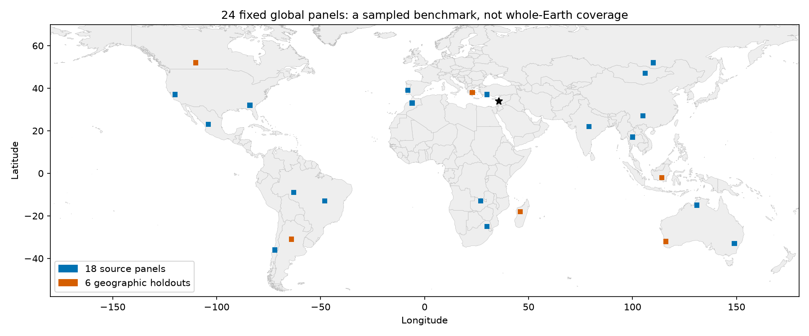
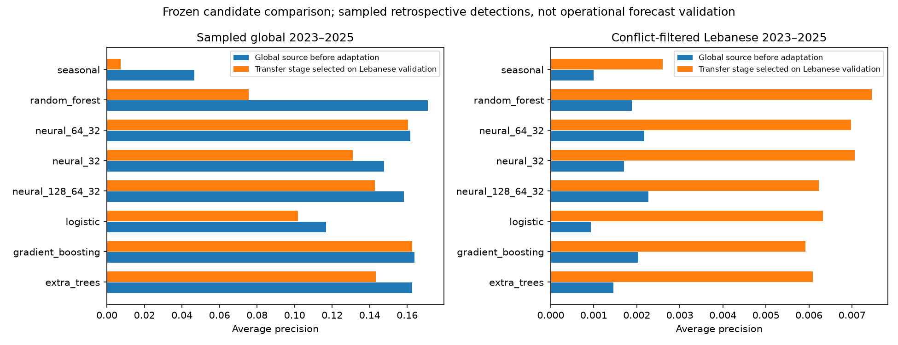
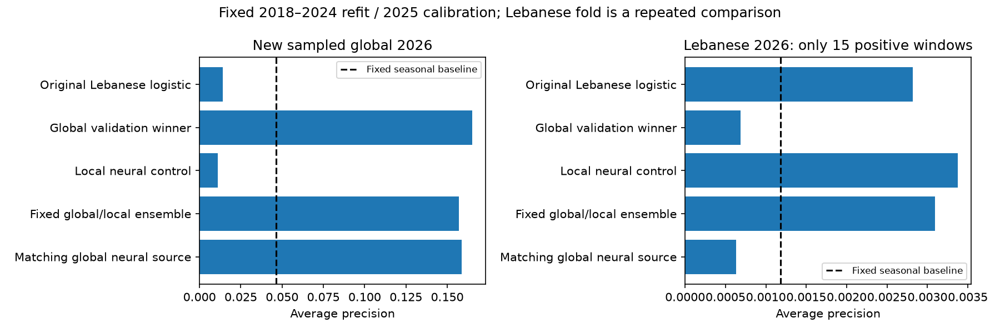
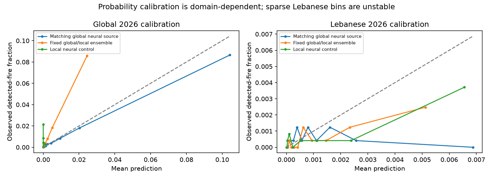
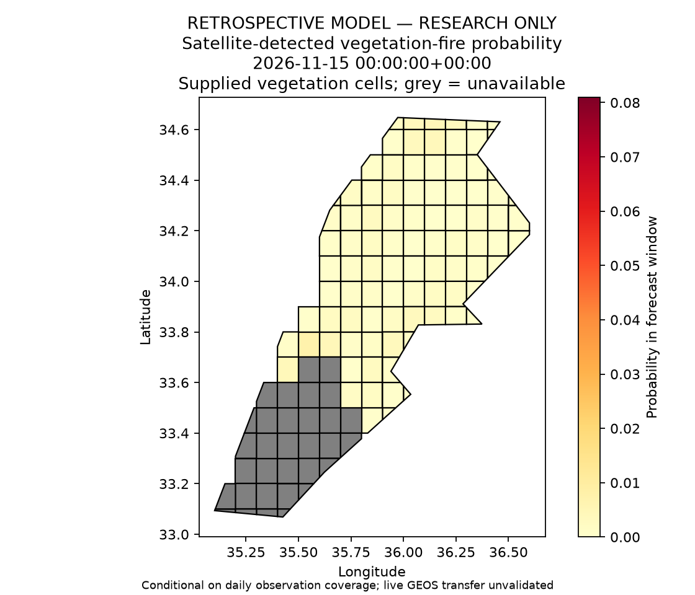

# Global training and Lebanon adaptation: actual results

**Completed real-data research benchmark. No operational model is approved.** The requested southern-Lebanon exclusion is implemented. Global training improves Lebanese ranking relative to zero-shot global prediction, but it does **not** establish an advantage over the matching local-only neural model. The selected transfer detected **0 of 15** eligible Lebanese 2026 positive windows at its frozen threshold.

[Machine-readable summary](global-results.json) · [Initial complete benchmark CSV](global-benchmark.csv) · [Initial full metrics](global-benchmark-metrics.json) · [Recent-data refit CSV](global-refit-benchmark.csv) · [Global statecharts](global-statecharts.md) · [Release rejection](global-release.json) · [Decisions](../../decisions.md)

## What was obtained

All meteorology, satellite fire/cloud masks, land cover and terrain predictors are NASA data. The user-authorized conflict-review geometry is CDR/OCHA administrative data; it is label/evaluation-quality information, not a model feature.

* Twenty-four fixed 2° × 2° panels span North/South America, Europe, Africa, Asia and Oceania. Eighteen panels supply training/calibration/validation; six complete panels are geographic holdouts. This is a **globally distributed sampled panel**, not exhaustive whole-Earth coverage or a probability sample of all land. Selected vegetated cells total 9,287; source-site and geographic-holdout groups have 7,077 and 2,210 cells respectively.
* Two deterministic dates per month, selected independently of fire outcomes, give 192 sampled dates in 2018–2025. All 4,608 selected available NOAA-20 daily tile sources were acquired. New 2026 collection retained 479 available sources out of 480 requested tile/date pairs; a missing catalogue granule remains missing evidence, never an invented negative.
* NASA POWER acquisition returned 1,133,952 historical global weather point-days at 384 points, plus 128,640 recent-history/2026 point-days. These counts overlap in December 2025. No requested meteorology values were missing. POWER is observed/reanalysis-derived historical weather, **not an issued forecast archive**.
* Global source subsets retain exact selected VJ114A1.002 `FireMask` and `QA`, MCD12Q1.061 raw classes/QC and SRTMGL1.003 elevation samples. Original NASA URLs, retrieval times, original-container hashes and retained-subset hashes are recorded. Temporary whole source containers are discarded after exact selected raw scientific arrays are preserved. Original Lebanese data are retained; inactive S-NPP originals were losslessly packed with verified member hashes and a tested restore command.
* The target remains **NOAA-20 daily nominal 1km detected vegetation-associated fire**, derived from the VIIRS 750m-band algorithm. It is not FIRMS 375m completeness, true wildfire occurrence, new ignition alone, spread, damage or infrastructure impact. Cropland is included; remaining thermal detections are not certified clean.

## Cleaning, coverage and conflict exclusions

Native source pixels are located on the sinusoidal grid, screened using exact categorical MCD12Q1.061 QC, aggregated to the configurable 0.1° grid and joined to NASA weather. This is roughly 11.1km north–south and 9.2km east–west near Lebanon; coarse POWER/GEOS fields do not provide that weather resolution in mountainous terrain. Historical static 2010 land-cover observations were later reprocessed; their historical version availability is not asserted. Weather features include temperature, humidity, precipitation, wind components, lagged seven/thirty-day rainfall, recent temperature and a vapour-pressure-deficit proxy; static features include vegetation fraction, elevation, slope and circular aspect. Location/hemisphere seasonality is explicit. No full NDVI or fuel-moisture history is fabricated.

Both fitting classes require at least 80% processed eligible area and no unknown-fire class. Missing/cloudy examples, low-coverage positives and excluded detections keep null fitting labels. A fire outside vegetation eligibility or with incompatible land QA quarantines its whole cell-window. Conservative filtering retains low-confidence daily fire; strict filtering quarantines it. Original Lebanese FIRMS type/confidence/recurrence review is preserved. Global and 2026 labels lack the same complete FIRMS review stream; this is a material label-domain limitation. Repeated locations are review candidates, not proven industrial sources.

The [raw QA audit](global-qa-audit.json) checked all 5,825 original Lebanese NOAA-20 files and the new scientific subsets. Two incompatible-QA fire pixels occur in one Chilean 2023 cell-window; it already had a null target under both policies. Tightening the future guard changes no fitted target or numerical result. No such eligible-pixel inconsistency was found in the original Lebanese archive or the 2026 subsets.

For conflict quality, **South (LB6) and El Nabatieh (LB4)** polygons from the [CDR/OCHA COD boundary dataset](https://data.humdata.org/dataset/cod-ab-lbn), exact ADM1 layer `lbn_admin1.geojson`, are buffered by 1km in UTM 36N. Every intersecting cell-window overlapping **2023-10-07 00:00 UTC onward** is quarantined, with no assumed end date. This affects 32 of the 124 eligible Lebanese cells. The boundary archive, source API response, version and CC BY-IGO attribution are retained.

| Lebanese split | Quarantined windows | Previously qualified positive windows quarantined | Remaining qualified windows | Remaining positive windows |
|---|---:|---:|---:|---:|
| Known 2023–2025 benchmark | 25,888 | 143 | 95,751 | 137 |
| Fixed 2026 fold | 9,504 | 68 | 24,237 | 15 |

Original labels/reasons/sources stay in the audit. An exclusion is **not** a negative and does not prove a strike caused that fire. [ACLED requires authorized access](https://acleddata.com/faq/how-can-i-access-and-use-acled-data) and aggregates some events; no exhaustive accessible strike-to-fire catalogue was obtained. [UN reporting documents attacks outside the south](https://www.un.org/sg/en/content/highlight/2024-10-16.html), so the rest of Lebanon is not certified conflict-free. Scores from the earlier unmasked Lebanese run cannot be compared as if the evaluation population had stayed unchanged.

## Benchmark protocol and algorithms

The initial fitting period is 2018–2020, separate calibration is 2021, and hyperparameter/threshold selection uses 2022. Seven-day split-boundary gaps prevent overlapping target windows. Six geographic panels never enter source fitting or calibration. Global 2023–2025 temporal/geographic results were opened after every retained model and selection was frozen. Lebanese 2023–2025 is an already-viewed historical benchmark. The first fixed Lebanese 2026 comparison was new at that stage; subsequent reuse is explicitly labelled.

There were **89 validation candidates**, **58 frozen stage winners**, and **nine conservative-policy controls**. Six algorithm types yield eight model/architecture groups: seasonal climatology, logistic regression, random forests, extra trees, histogram gradient boosting and dense neural networks with hidden layers `(32)`, `(64,32)` and `(128,64,32)`. Source hyperparameters are chosen on global validation; local settings are chosen on Lebanese validation. Calibrators are sigmoid models fitted on separate natural-prevalence calibration rows.

Approaches include source-only prediction, local-only controls, global or Lebanese probability calibration, global/local ensembles, regularized local logistic coefficients anchored to the global solution, pretrained-global-score local trees, pooled fitting and actual neural weight continuation with a frozen global scaler. Class-balanced forest/linear variants and a positive-weighted neural optimizer are compared explicitly; their probabilities are not assumed calibrated merely because a calibrator was fitted. No negative-only downsampling is used. No CNN/sequence claim is made for an irregularly sampled tabular panel on CPU.

The source fit used **401,767 windows / 5,769 positives**, while the Lebanese fit used **117,677 / 202**. Lebanese 2021 calibration has 98 positives and 2022 validation only **32**; 89 validation candidates against such a small local positive count creates substantial selection-instability risk. The validation-selected global winner was the calibrated 128–64–32 network. The best transfer was a 64–32 global/local ensemble with **75% local weight**; a local-only 64–32 network had the highest overall Lebanese validation AP. Weight-continuation candidates were genuinely trained, but did not win the chosen validation rule.

| Model group | Transfer stage selected on Lebanese validation | Lebanese validation AP | Global 2023–2025 AP | Known filtered Lebanese 2023–2025 AP |
|---|---|---:|---:|---:|
| extra_trees | ensemble | 0.00378 | 0.14326 | 0.00609 |
| gradient_boosting | pooled | 0.00271 | 0.16257 | 0.00592 |
| logistic | ensemble | 0.00295 | 0.10188 | 0.00633 |
| neural_128_64_32 | local_adaptation | 0.00342 | 0.14264 | 0.00623 |
| neural_32 | local_adaptation | 0.00317 | 0.13096 | 0.00707 |
| neural_64_32 | ensemble | 0.00624 | 0.16036 | 0.00698 |
| random_forest | ensemble | 0.00348 | 0.07542 | 0.00746 |
| seasonal | lebanon_calibration | 0.00133 | 0.00743 | 0.00261 |

All family stages shown above were chosen on validation, not by sorting test scores. The complete CSV includes every retained model, both domains, precision/recall/F1, Brier, confusion counts, calibration, region/season summaries and frozen decision thresholds. The conservative sensitivity compares fixed seasonal/logistic/boosting source, local and calibrated controls; do not select a filtering policy by lower error on a different target population.

## Fixed recent-data refit and further confirmation

Before manually reviewing numerical 2026 outcomes, one additional protocol was fixed from the immutable validation selection: refit unchanged source/local recipes on **2018–2024**, calibrate on **2025**, and acquire new global 2026 confirmation. The actual refit has **949,823 global windows / 12,903 positives** and **260,804 Lebanese windows / 428 positives**. Separate 2025 calibration has 129,656 global and 28,808 Lebanese windows. The old 2023–2025 source temporal data now serve as fit/calibration data for this refit and are **not** its temporal holdout.

New global 2026 has 113,942 qualified source-site windows / 1,402 positives, plus 34,407 geographic-holdout windows / 604 positives. The Lebanese 2026 fold had already been automatically scored by the first fixed benchmark; its refit comparison is **not a new independent Lebanese confirmation**. No confirmation score changes the recipe, mixture, learning rate or architecture. Thresholds include explicitly recorded carried 2022 rules and 2025 calibration-F1 rules; neither uses 2026 outcomes.

| Fixed model/control | Global 2026 temporal AP | Global 2026 geographic AP | Lebanese 2026 AP | Lebanese Brier |
|---|---:|---:|---:|---:|
| Global neural source, before adaptation | 0.15868 | 0.09702 | 0.00063 | 0.00062538 |
| Fixed global/local neural ensemble | 0.15719 | 0.09702 | 0.00309 | 0.00061904 |
| Matching local-only neural control | 0.01094 | 0.01750 | 0.00337 | 0.00062003 |
| Local neural control + calibration | 0.01185 | 0.01755 | 0.00337 | 0.00062069 |
| Validation-selected global neural winner | 0.16497 | 0.09080 | 0.00069 | 0.00062083 |
| Original Lebanese logistic reference | 0.01399 | 0.10261 | 0.00282 | 0.00062005 |

The selected transfer raises Lebanese AP from **0.00063** for its matching zero-shot global source to **0.00309**, but the matching local-only control reaches **0.00337**. The paired monthly-block AP difference, transfer minus local, is **-0.0002815**, with conditional bootstrap interval **[-0.0007043, -0.0000486]**. This diagnostic favors the local control, but only 15 positives/10 months and unresolved label uncertainty limit inference. It does not justify promoting a different model after viewing confirmation.

On source-site global 2026 data, matching-model AP changes **0.15868 → 0.15719**, while Brier worsens **0.011185 → 0.011702** after universal Lebanese adaptation. Adapted mean probability is about **0.00346**, against observed global prevalence **0.01230**: local calibration damages global probability calibration even where ranking is retained. The global validation winner reaches AP **0.16497** on source sites and **0.09080** on held-out sites; geographic recall is only **0.66%** at its frozen threshold. These numbers do not establish worldwide deployment reliability.

The Lebanese transfer's primary frozen threshold is **0.08092745**. Confusion **TN/FP/FN/TP = 24222 / 0 / 15 / 0**: no positive predictions and all 15 positive windows missed. The carried 2022 threshold also detects none. Lebanese prevalence is **0.000619**; fixed seasonal AP is **0.001178**, Brier **0.00062042**. The selected Brier **0.00061904** is slightly better than seasonal, but slightly worse than the zero-probability diagnostic **0.00061889**. Rare-event Brier improvements cannot substitute for useful detection.

The selected Lebanese AP monthly-block interval is **0.000579–0.005473**; the global interval is **0.05426–0.22180**. These condition on fitted weights/labels, omit source/label uncertainty and do not prove independent incidents. All 2026 results are now known benchmarks; further model development needs a newly reserved confirmation design.

## Genuine issued-weather research output

The selected research artifact accepts the shared feature contract. A complete NASA GEOS cycle issued **2026-11-14 00 UTC** supplies the **2026-11-15 UTC** target day; original issue/valid times, 24 complete hourly intervals and actual retrieval timestamps are retained. New antecedent 7/30-day rain and recent temperature use only actually retrieved past POWER values ending three days before prediction. No historical source availability is invented.

The country view exports CSV, country-clipped GeoJSON and PNG for 124 eligible cells, withholding the 32 conflict-scope cells. The remaining 92 probabilities retain retrospective, coverage-conditioned and POWER-to-GEOS source-transfer warnings; one also flags an input outside fit feature ranges. The generic sampled-global artifact retains its domain metadata. No result is a probability of spread, damage or reaching a transmission line.

## Reproduction, checks and release status

Follow [global reproduction instructions](../README.md#global-pretraining-and-lebanon-adaptation), using the locked Python environment and a private Earthdata token-file path. Notebooks **07** and **08** call the shared modules for real acquisition/label inspection and frozen evaluation; source/model logic is not independently reimplemented in notebooks. The earlier notebooks and local-only reports remain historical stages. Model/data outputs stay local and git-ignored; committed JSON/CSV/figures retain the evidence needed for review.

The initial full fit/evaluation took approximately **362 seconds** on this CPU-only runtime; source download and subset construction take additional time. Use at least 4–8 GB RAM and 12–16 GB free disk for full reproduction including container operations. Actual software versions and exact split/source/selection/artifact hashes are in the JSON records and lock. Never load untrusted joblib artifacts.

The [release record](global-release.json) remains **approved: false**. Failed requirements include operational forecast mode, historical feature availability, a multi-year issued-meteorology backtest, independent incident review, acceptable calibration, Lebanese test size and test duration. The container/serving implementation does not make the model scientifically ready. Current service/check results are in [production status](production-status.json); no external model deployment has occurred.

Remaining work is substantive: matching issued-forecast histories or prospective forecast collection, stronger 375m-compatible/independent incident labels, historically available vegetation/fuel indicators, more informative local confirmation events, geographic/temporal robustness and defensible action thresholds. The broad southern exclusion is implemented, but authoritative strike/facility/managed-burning attribution is incomplete. Do not keep retuning against the now-viewed 2026 outcomes or describe this model as production-ready.

Final validation evidence: **74 focused tests passed** (one Starlette test-client
deprecation warning). All eight notebook files passed schema validation; the two
new global notebooks executed successfully against actual source/model artifacts.
The latest refitted service smoke returned health 200, readiness 503 and forecast
503 with its failed release record. Python compilation, whitespace and credential
scans were also performed. GitHub CI and a fresh global-extension container build
are not claimed as completed remote checks.
