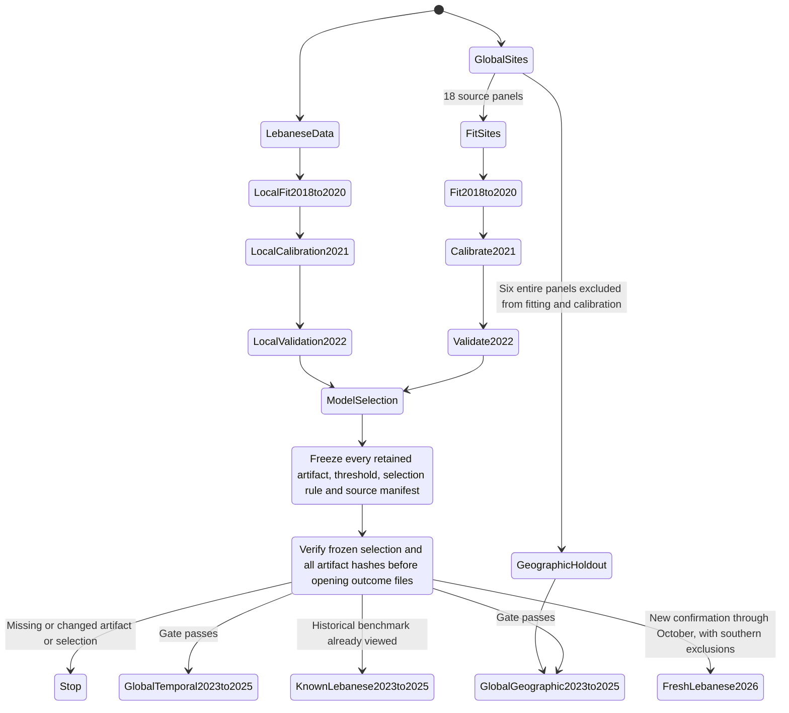
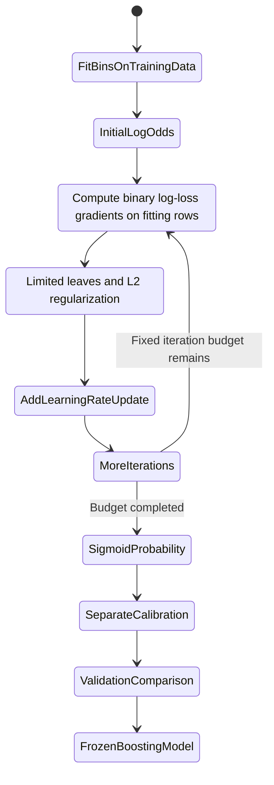

# Global pretraining, Lebanon adaptation and conflict-filtered evaluation

These diagrams describe the implemented global experiment. Actual completion status,
coverage and numerical results belong in `global-results.md` and the generated run
records; a diagram is not proof that a state completed. The original Lebanon-only
pipeline remains documented in [statecharts.md](statecharts.md).

## NASA acquisition and global sampling

```mermaid
stateDiagram-v2
    [*] --> FixedDesign
    FixedDesign: 24 fixed 2 degree panels; two outcome-independent dates per month; 2018 to 2025
    FixedDesign --> StaticNASA
    StaticNASA: 2010 MCD12Q1 classes and QA; SRTM elevation; original raw selected samples retained
    FixedDesign --> POWER
    POWER: Six variables; 16 sampling points per panel; daily contiguous history
    FixedDesign --> FireCatalogue
    FireCatalogue: NOAA-20 VJ114A1.002; exact tile and acquisition dates
    FireCatalogue --> ProcessingVersions
    ProcessingVersions: Preserve all catalogue versions; choose latest processing timestamp per day
    ProcessingVersions --> SourceBytes
    SourceBytes: NASA HTTPS authentication; verify product, date and class range
    SourceBytes --> RawSubsets
    RawSubsets: Retain unfiltered mask and QA pixels; source URL, source hash, subset hash and retrieval time
    StaticNASA --> PixelMaps
    PixelMaps: Native pixel centres; land-cover QA; vegetation eligibility; terrain features; configurable grid
    PixelMaps --> RawSubsets
    RawSubsets --> DailyPanel
    DailyPanel: Retain every configured cell and sampled date, including no-detection observations
    POWER --> LaggedHistory
    LaggedHistory: Seven and thirty day rain; recent temperature; three day availability lag
    LaggedHistory --> Features
    DailyPanel --> Features
    Features: Spatial join and observed weather; explicit retrospective mode
```

Global results describe this sampled panel. They do not describe every country,
every climate, a uniform sample of all land, or a fully deployed global system.
Transient complete remote containers are discarded only after exact selected raw
scientific arrays and provenance are retained. The existing Lebanese archive stays intact.

## Cleaning and label construction

```mermaid
stateDiagram-v2
    [*] --> RawPixelClasses
    RawPixelClasses --> Coverage
    Coverage: Processed eligible land divided by fixed eligible area
    Coverage --> NonTargetReview
    NonTargetReview: Known noneligible fire and low-confidence class retained in audit
    NonTargetReview --> Conservative
    NonTargetReview --> Strict
    Conservative: Quarantine noneligible fire and unusable observations
    Strict: Also quarantine low-confidence daily fire
    Conservative --> LabelGate
    Strict --> LabelGate
    state LabelGate <<choice>>
    LabelGate --> Excluded: Any policy quarantine
    LabelGate --> Positive: Eligible fire and at least 0.8 processed fraction; no unknown-fire class
    LabelGate --> Negative: No eligible fire; same qualified coverage rule
    LabelGate --> LowCoveragePositive: Detected fire but coverage fails
    LabelGate --> Uncertain: Cloud, missing data or unknown fire prevents qualification
    Excluded: Null fitting label; never a negative
    LowCoveragePositive: Preserve known detection; null fitting label
    Uncertain: Null fitting label; never a negative
    Positive --> FeatureCheck
    Negative --> FeatureCheck
    FeatureCheck --> FitEligible: All finite required features
    FeatureCheck --> ExcludedFeature: Missing feature; no invented replacement
```

Global mask labels lack the full original FIRMS source-type/confidence review
available for older Lebanese labels. The 2026 Lebanese source masks also lack that
older FIRMS review stream. Recurrence is a training-era candidate for review, not
proof of an industrial source. The original Lebanese filtering audit remains preserved.
These differences are explicit limitations, not evidence that all remaining fires
are weather-driven wildfires.

## Conflict contamination exclusion

```mermaid
stateDiagram-v2
    [*] --> UserPolicy
    UserPolicy: Exclude southern Lebanon starting 7 October 2023; no assumed end date
    UserPolicy --> CDR_OCHA_Boundaries
    CDR_OCHA_Boundaries: Exact South LB6 and El Nabatieh LB4 polygons; CC BY-IGO attribution
    CDR_OCHA_Boundaries --> MetricBuffer
    MetricBuffer: Project to UTM 36N; apply 1 km uncertainty buffer
    MetricBuffer --> SpatialIntersection
    SpatialIntersection: Whole grid cell intersects buffered region
    SpatialIntersection --> TimeOverlap
    state TimeOverlap <<choice>>
    TimeOverlap --> Quarantine: Lebanese forecast window overlaps exclusion period
    TimeOverlap --> OtherQualityChecks: Otherwise
    Quarantine --> PreserveBeforeLabel
    PreserveBeforeLabel: Retain original label, reason, policy ID, boundary source and raw detections
    PreserveBeforeLabel --> NullTarget
    NullTarget: Excluded from every model comparison and confirmation metric
    OtherQualityChecks --> QualifiedEvaluation
    note right of Quarantine
        This does not establish strike causation.
        The rest of Lebanon is not certified conflict-free.
        No exhaustive accessible strike catalogue was obtained.
        Conflict review fields never enter model features.
    end note
```

## Separate fitting, calibration, validation and confirmation



Seven-day temporal boundary gaps prevent overlapping forecast windows across splits.
They do not prove independent incidents. Confirmation results never send the control
flow back into tuning; further development after this confirmation needs new data.

## Algorithms and actual adaptation methods

```mermaid
stateDiagram-v2
    [*] --> PredeclareFamilies
    PredeclareFamilies --> Seasonal
    PredeclareFamilies --> Logistic
    PredeclareFamilies --> RandomForest
    PredeclareFamilies --> ExtraTrees
    PredeclareFamilies --> HistogramBoosting
    PredeclareFamilies --> DenseNeuralNetworks
    DenseNeuralNetworks: Hidden layers 32; 64 and 32; 128 and 64 and 32
    Seasonal --> GlobalFit
    Logistic --> GlobalFit
    RandomForest --> GlobalFit
    ExtraTrees --> GlobalFit
    HistogramBoosting --> GlobalFit
    DenseNeuralNetworks --> GlobalFit
    GlobalFit: Fit preprocessing only on source training rows
    GlobalFit --> SourceValidation
    SourceValidation: Choose source hyperparameters using global 2022 validation
    SourceValidation --> GlobalCalibration
    SourceValidation --> LebanonCalibration
    SourceValidation --> GlobalLocalEnsemble
    SourceValidation --> LocalAdaptation
    SourceValidation --> PooledControl
    GlobalCalibration: Sigmoid probability calibration on global 2021
    LebanonCalibration: Sigmoid probability calibration on Lebanese 2021
    GlobalLocalEnsemble: Mix global and locally fitted predictions; tune mixture on validation
    PooledControl: Fit selected family from scratch on combined source and Lebanese training rows
    LocalAdaptation --> AnchoredLinear: Logistic source
    LocalAdaptation --> ContinuedWeights: Neural source
    LocalAdaptation --> SourceScoreTree: Tree source
    AnchoredLinear: Local binary cross-entropy plus penalty toward global coefficients
    ContinuedWeights: Preserve global scaler and pretrained weights; continue Adam on local training rows
    SourceScoreTree: Fit local tree with local features plus pretrained global score; global tree weights unchanged
    AnchoredLinear --> LocalCalibration
    ContinuedWeights --> LocalCalibration
    SourceScoreTree --> LocalCalibration
    LocalCalibration: Fit sigmoid on separate natural-prevalence Lebanese 2021 rows
    LocalCalibration --> LebaneseValidationSelection
```



Neural variants compare width/depth, iteration budget, regularization, adaptation
learning rate/epochs and one positive-weighted local optimizer. Weighted optimization
changes the effective class prior; separate calibration is measured, not assumed to
repair it. No random validation split inside the neural estimator can mix later
observations into earlier fitting. GPU-scale CNN/sequence models are not justified
by this irregularly sampled tabular design and CPU-only runtime.

## Before/after benchmarks and final confirmation

```mermaid
stateDiagram-v2
    [*] --> SourceModel
    SourceModel --> GlobalValidation
    SourceModel --> LebaneseValidation
    GlobalValidation --> AdaptationRound
    LebaneseValidation --> AdaptationRound
    AdaptationRound --> GlobalValidationAfter
    AdaptationRound --> LebaneseValidationAfter
    GlobalValidationAfter --> RecordForgetting
    RecordForgetting: Report global gains or losses after universal local adaptation
    LebaneseValidationAfter --> RecordLocalSkill
    RecordLocalSkill: AP, Brier, calibration, F1 and validation-selected decision thresholds
    RecordForgetting --> NextPredeclaredCandidate
    RecordLocalSkill --> NextPredeclaredCandidate
    NextPredeclaredCandidate --> AdaptationRound: Candidate budget remains
    NextPredeclaredCandidate --> FreezeFinalChoices: Candidate budget completed
    FreezeFinalChoices --> ReservedConfirmation
    ReservedConfirmation --> SamePopulationComparison
    SamePopulationComparison: Identical source, policy and conflict exclusions for every compared model
    SamePopulationComparison --> ReportGlobalAndLebanon
    ReportGlobalAndLebanon: Temporal and geographic global results; known Lebanese benchmark; fresh 2026 confirmation
    ReportGlobalAndLebanon --> ResearchOnly
    ResearchOnly: Historical weather and imperfect labels still prevent operational approval
```



Local-only controls and the previous fixed Lebanese model are measured on the same
newly filtered evaluation population. Better numbers after changing exclusions must
not be attributed entirely to model improvement. Global metrics are micro-averaged
and site-macro summaries, with region/season breakdowns for selected choices.

## Forecast interface and production boundary

```mermaid
stateDiagram-v2
    [*] --> ActualGEOSForecast
    ActualGEOSForecast: Forecast issue and actual retrieval precede prediction; all target hours present
    ActualGEOSForecast --> AvailableHistory
    AvailableHistory: Genuine prior 7 and 30 day rainfall and temperature; no future or missing values
    AvailableHistory --> SharedFeatureContract
    SharedFeatureContract --> SelectedResearchArtifact
    SelectedResearchArtifact --> DomainChecks
    DomainChecks: Source, grid, timestamps, feature support and conflict-filtered evaluation scope
    DomainChecks --> FlaggedResearchOutput
    FlaggedResearchOutput: CSV, GeoJSON and map retain retrospective, source-transfer and coverage warnings
    FlaggedResearchOutput --> ProductionGate
    ProductionGate --> Blocked: Issued-forecast backtest, historical availability and other evidence incomplete
    ProductionGate --> Approved: Independent operational evidence eventually passes
```



## Fixed newer-data refit and confirmation accounting

```mermaid
stateDiagram-v2
    [*] --> OriginalValidationSelection
    OriginalValidationSelection: Fixed 64 and 32 layer neural ensemble; 75 percent local weight
    OriginalValidationSelection --> CaptureProtocolHash
    CaptureProtocolHash: Capture current immutable selection; reject a changed selection lease
    CaptureProtocolHash --> RefitThrough2024
    RefitThrough2024: Reuse chosen source/local architectures and settings; no new search
    RefitThrough2024 --> CalibrateOn2025
    CalibrateOn2025 --> FreezeRefitAndThresholds
    FreezeRefitAndThresholds --> Global2026NewData
    FreezeRefitAndThresholds --> Lebanese2026RepeatedFold
    Global2026NewData: New sampled temporal and geographic confirmation
    Lebanese2026RepeatedFold: Same fold automatically scored earlier; not newly independent
    Global2026NewData --> ReportAllControls
    Lebanese2026RepeatedFold --> ReportAllControls
    ReportAllControls: Matching global source, selected transfer, local controls, global winner and legacy model
    ReportAllControls --> KeepSelectionFrozen
    KeepSelectionFrozen: Do not replace the chosen recipe using confirmation scores
    KeepSelectionFrozen --> ResearchOnly
    ResearchOnly: 15 local positive windows; no detected positives at frozen threshold; release blocked
```



Exact graph counts and outcome values are in [global-results.md](global-results.md).
The country forecast view withholds 32 conflict-scope cells; it does not learn a
strike indicator. Reproduction does not make already-viewed confirmation outcomes
fresh again. New model-development rounds need a new confirmation design.

## Neural model logic and actual weight fine-tuning

```mermaid
stateDiagram-v2
    [*] --> NineteenFeatures
    NineteenFeatures: Weather, lagged history, vegetation, terrain, latitude and seasonality
    NineteenFeatures --> TrainingScaler
    TrainingScaler: Fit mean and scale on fitting rows only
    TrainingScaler --> HiddenArchitecture
    state HiddenArchitecture <<choice>>
    HiddenArchitecture --> ReLU32
    HiddenArchitecture --> ReLU64Then32
    HiddenArchitecture --> ReLU128Then64Then32
    ReLU32 --> OutputSigmoid
    ReLU64Then32 --> OutputSigmoid
    ReLU128Then64Then32 --> OutputSigmoid
    OutputSigmoid --> TrainingLoss
    TrainingLoss: Binary cross-entropy plus L2; optimizer weights recorded explicitly
    TrainingLoss --> AdamUpdates
    AdamUpdates --> FixedEpochBudget
    FixedEpochBudget --> ValidationComparison
    ValidationComparison --> SourceCheckpoint
    SourceCheckpoint --> LocalWeightContinuation
    LocalWeightContinuation: Copy weights; freeze global scaler; restart local Adam at chosen learning rate
    LocalWeightContinuation --> LocalCalibration
    LocalCalibration: Sigmoid calibration on separate natural-prevalence calibration year
    LocalCalibration --> BothDomainValidation
    BothDomainValidation --> FrozenArtifact
```



Warm-start continuation preserves weights, not the old Adam optimizer moments.
The locally positive-weighted variant changes the effective training prior and
therefore requires measured calibration. Global/local probability ensembling is a
different adaptation method; it does not fine-tune the global network's weights.

## Random forests and extra trees

```mermaid
stateDiagram-v2
    [*] --> FittingRowsOnly
    FittingRowsOnly --> ForestType
    state ForestType <<choice>>
    ForestType --> BootstrapSample: Random forest
    ForestType --> TrainingSample: Extra trees
    BootstrapSample --> FeatureSubset
    TrainingSample --> FeatureSubset
    FeatureSubset --> SplitChoice
    state SplitChoice <<choice>>
    SplitChoice --> ImpuritySearch: Random forest split search
    SplitChoice --> RandomThresholds: Extra trees candidate thresholds
    ImpuritySearch --> RecurseWithinLimits
    RandomThresholds --> RecurseWithinLimits
    RecurseWithinLimits: Depth, leaf-count and minimum-leaf sample constraints
    RecurseWithinLimits --> LeafFrequency
    LeafFrequency: Weighted class frequency if class weighting is enabled
    LeafFrequency --> AverageTreeProbabilities
    AverageTreeProbabilities --> CalibrationAndValidation
    CalibrationAndValidation --> FrozenForest
    FrozenForest --> LocalScoreTransfer
    LocalScoreTransfer: Add pretrained source score to local inputs; fit local tree without changing source trees
```



## Histogram gradient boosting



No estimator uses a random early-stopping split that mixes future observations
into its fitting phase. Calendar cutoffs and explicit validation control model
choice; confirmation never provides gradients, scaling statistics or thresholds.
