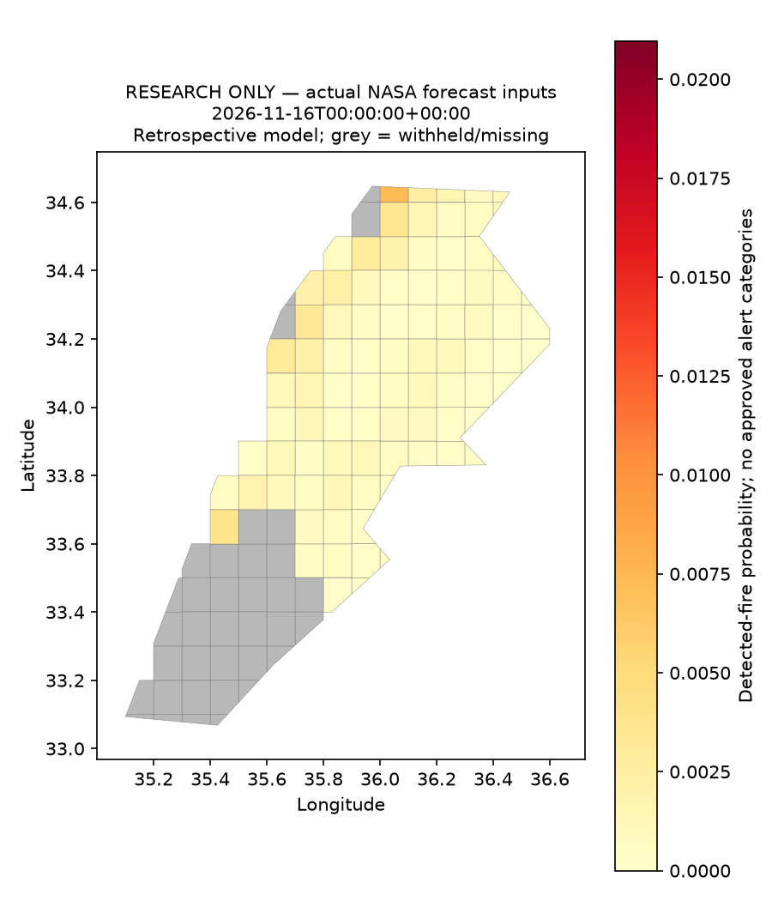

# Greek-inspired NASA temporal experiment: measured results

**Real-data fitting and new retrospective confirmation completed. Production approval remains false.**

This is an adaptation of the Greek methodology to our satellite-detected occurrence target, not a reproduction of its >30 ha danger labels or selected-negative precision. Existing 2026 January–October test scores did not select these models. The original 2022 validation remains development data; repeated model searches on only 32 Lebanese validation positives are unstable.

## NASA data obtained and cleaning

* 69 MOD13C2.061 monthly composites were obtained, retaining exact NDVI/quality/reliability subsets at 9,411 cell samples, source-container and subset hashes, URLs and retrieval timestamps. Global containers were transient. Resolution is 0.05°, not 250 m or the Greek study's 1 km.
* 751,608 POWER modeled soil-wetness point-days at 396 points were acquired. 3,796 missing/invalid wetness values remain missing; they never become zero wetness. GWETROOT/GWETTOP are dimensionless modeled relative wetness, not direct fuel moisture.
* Greek daily source collection retained 1,819 available VJ114A1.002 daily sources for 2018–2022. Missing catalogue days remain uncertain. The first two-days/month matched sample had no positive training examples; all dates were then acquired without selecting fire days.
* Outcome-independent development weather and terrain select 163 of 326 Greek cells. This is selected panel matching, not proof that all Greece resembles Lebanon.
* Fire labels retain the >=80% processed-vegetation rule, strict confidence screening, nonvegetation/QA quarantine and historical Lebanese review. New Greek/global labels do not have a complete FIRMS facility/incident review and are not certified clean.
* MODIS CMG bits 14–15 mean spatial contribution, unlike tiled MOD13 snow/shadow bits. Use clear land, good reliability, mandatory good QA and >=50% contribution; exclude climatology-filled reliability=4. This was verified before model fitting.
* NDVI is selected only after composite completion plus a declared 16-day lag, with a maximum age of 120 days. This lag is a retrospective design assumption, not proof of historical dissemination/version availability. Missing prior-change values have an explicit indicator.
* Ten-day weather/wetness sequences end four days before target day. Current-day historical POWER values remain perfect-weather forecast proxies; they are not issued forecasts. All models share the same feature-qualified rows, including weather-only ablations.

## Fitting and selection

Fit: 2018–2020; separate natural-prevalence calibration: 2021; model/threshold selection: 2022. Fourteen-day split gaps exceed the ten-day history plus three-day lag. Source scalers fit only training data. No negative-only resampling is used.

| Split | Feature-qualified windows | Positive windows | Positive windows excluded for missing features |
|---|---:|---:|---:|
| global-train | 379751 | 5605 | 164 |
| global-calibration | 130223 | 1716 | 38 |
| global-validation | 124883 | 1862 | 60 |
| lebanon-train | 109567 | 197 | 5 |
| lebanon-calibration | 35528 | 98 | 0 |
| lebanon-validation | 35086 | 32 | 0 |
| greek-train | 118678 | 67 | 1 |
| greek-calibration | 37199 | 54 | 1 |
| greek-validation | 37351 | 20 | 0 |

45 predeclared stage candidates compare seasonal, logistic, random-forest, actual XGBoost, and 32/64-unit LSTM models; logistic/XGBoost weather-only controls isolate the added inputs on identical rows. LSTMs train for 10 epochs; adaptation continues weights for 6 epochs with frozen source scalers and a reset optimizer. Capped square-root positive weighting is followed by separate calibration. Tree/logistic transfer refits a local model with its frozen parent score; it does not fine-tune tree weights.

Validation choices: global `lstm64-global`; Lebanese overall `lstm64-lebanon`; transfer `logistic-global_greek_lebanon`. All artifacts and thresholds were hashed/frozen before the new confirmation fire collection. A separate fixed regional router uses the selected global model outside Lebanon and the selected transfer inside Lebanon; it does not refit or optimize from test outcomes.

## New confirmation: 1 and 7 November 2026

These outcome-independent dates were registered before their fire labels were acquired. They are new retrospective diagnostic examples, not a prospective operational backtest. Only two dates cannot establish seasonal robustness or useful local rare-event performance. Greece enters regional training in this protocol and is removed from independent geographic testing; five other full global panels remain held out.

| Domain | Qualified windows | Positive windows | Conflict-quarantined windows |
|---|---:|---:|---:|
| global_temporal | 9946 | 38 | 0 |
| global_geographic | 3163 | 53 | 0 |
| lebanon | 172 | 0 | 64 |

| Validation-fixed model/control | Global temporal AP | Global geographic AP | Lebanese AP |
|---|---:|---:|---:|
| lstm64-global | 0.01914 | 0.02771 | not estimable |
| lstm64-lebanon | 0.00353 | 0.01676 | not estimable |
| logistic-global_greek_lebanon | 0.00253 | 0.01526 | not estimable |
| regional_router | 0.01914 | 0.02771 | not estimable |
| logistic-global | 0.01148 | 0.02796 | not estimable |
| logistic-greek | 0.00351 | 0.01676 | not estimable |
| logistic-lebanon | 0.00254 | 0.01536 | not estimable |

AP is average precision, not accuracy. A single-class test has undefined AP here and is reported as not estimable. Full precision/recall/F1, Brier, ROC-AUC, calibration and confusion counts are in the [result JSON](greek-experiment-results.json) and [CSV](greek-confirmation-benchmark.csv). These are the same populations across candidates; they differ from the old 2023–2025 and January–October 2026 tests and cannot establish improvement by direct comparison with those old scores.

The selected transfer confusion matrices are:

* global_temporal: TN/FP/FN/TP = [1277, 8631, 6, 32]; frozen threshold 3.167377599311294e-06; precision 0.0036938704836661663, recall 0.8421052631578947.
* global_geographic: TN/FP/FN/TP = [670, 2440, 12, 41]; frozen threshold 3.167377599311294e-06; precision 0.01652559451833938, recall 0.7735849056603774.
* lebanon: TN/FP/FN/TP = [171, 1, 0, 0]; frozen threshold 0.01506722066551447; precision 0.0, recall 0.0.

No test score changes the selected model, architecture, calibration, mixture or threshold. A high score on two November dates is not production readiness; a low score is retained. Further development must reserve new confirmation outcomes again.

## Reproduction and limitations

See [the forecasting README](../README.md#greek-inspired-temporal-experiment) and [statecharts](greek-temporal-statecharts.md). The optional CPU research dependencies are separate from the base uv.lock environment. Notebook 10 reads the shared modules and actual artifacts. Never load untrusted joblib files.

NASA source access, point/subset provenance, split/tensor hashes, fitted parameters, runtime versions, seeds, model hashes, training losses and frozen selections are retained in local artifacts and committed reports. Original inactive daily-fire caches were losslessly packed and verified, not deleted; restore instructions are in the README.

Remaining limitations: sparse global label dates, few independent local fire events, old/reprocessed land cover, coarse wetness/NDVI, unresolved managed/industrial/conflict attribution outside the broad exclusion, and no multi-year issued-forecast validation. ConvLSTM was not trained: coherent 1 km spatial histories and adequate independent incidents are lacking. The API release gate remains closed.

## Broader historical benchmark: already-known later years

The new November fold contains **zero Lebanese positive windows**; Lebanese AP and recall cannot be estimated from it. Further reporting therefore evaluates the same frozen models on already-viewed later years. These outcomes are not used for renewed selection and are not fresh independent confirmation. No weights, calibrators or thresholds change.

An additional 41 MODIS monthly composites and 542,124 POWER soil-wetness point-days complete the later-year feature history: **110 monthly composites and 1,293,732 soil-wetness point-days total**. Original fitting datasets/manifests remain unchanged. All-month raw subsets and their QA remain separately versioned.

| Known evaluation cohort | Feature-qualified windows | Positive windows |
|---|---:|---:|
| global_known_2023_2025 | 408,500 | 4913 |
| geographic_known_2023_2025 | 92,100 | 1394 |
| lebanon_known_2023_2025 | 92,746 | 133 |
| lebanon_known_2026_JanOct | 23,367 | 15 |

| Frozen model/control | Source-panel 2023–2025 AP | Five held-out panels AP | Lebanese 2023–2025 AP | Known Lebanese Jan–Oct 2026 AP |
|---|---:|---:|---:|---:|
| lstm64-global | 0.17338 | 0.05939 | 0.00297 | 0.00215 |
| lstm64-lebanon | 0.01024 | 0.01507 | 0.00775 | 0.00436 |
| logistic-global_greek_lebanon | 0.00827 | 0.01855 | 0.00612 | 0.00276 |
| lstm64-global_greek_lebanon | 0.05837 | 0.07829 | 0.01414 | 0.00515 |
| xgboost-global | 0.16809 | 0.05266 | 0.00218 | 0.00174 |
| xgboost_weather-global | 0.14228 | 0.05484 | 0.00158 | 0.00073 |

The common source-panel evaluation includes the original 18 global panels plus Greece, which is a source region in regional-training arms. The pure global model itself never trained on Greece. Five other geographic panels remain unseen by every fitting arm. Do not compare this population directly with the earlier six-panel holdout or infer worldwide skill.

The global LSTM and enriched XGBoost retain useful source-panel ranking, with much weaker geographic transfer. Enrichment improves XGBoost ranking over its weather-only control on source panels, but not on held-out panels. The neural Greek/Lebanon chain looks better on the known Lebanese benchmark than its matching source; it **did not win validation** and is not promoted after viewing these scores. The validation-selected local-only LSTM remains the overall Lebanese candidate, while the selected logistic transfer does not establish a local advantage.

For the validation-selected local-only model on known Lebanese January–October 2026, TN/FP/FN/TP = [23300, 52, 15, 0]. All 15 positives are missed at its frozen threshold. The neural chain detects 3/15 there with 508 false alerts; this is a retained diagnostic, not an independently validated alert policy.

Full historical [JSON](greek-known-benchmark.json) and [CSV](greek-known-benchmark.csv) include every retained model. There are only 133 eligible positive Lebanese windows in 2023–2025 and 15 in the known 2026 fold; these windows are not certified independent incidents. These constraints, weak precision and the lack of issued-weather backtesting keep release approval false.

## Actual issued-forecast research output

NASA GEOS issued 2026-11-14 00 UTC supplies the 24-hour window beginning 2026-11-16T00:00:00+00:00. All 72 hourly field subsets completed. Actual recent NASA POWER weather/wetness and selected MODIS observations were retrieved before that future prediction time. The local model returns 88 probabilities over 124 eligible cells; 32 cells are flagged in the southern conflict scope. Missing vegetation remains unavailable, including overlapping reasons.

This demonstrates ingestion and research inference, not operational skill. CSV/GeoJSON/JSON outputs retain model hashes, issue/availability times and limitations. The interface accepts no fire labels; future/missing inputs, wrong history windows and conflict scope suppress predictions. The production API remains gated.
