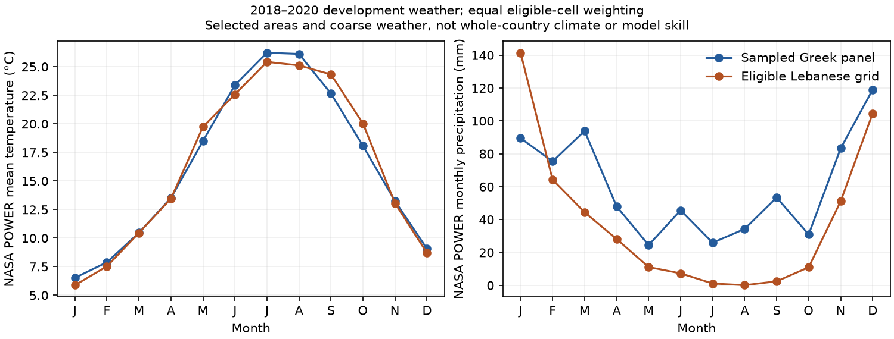
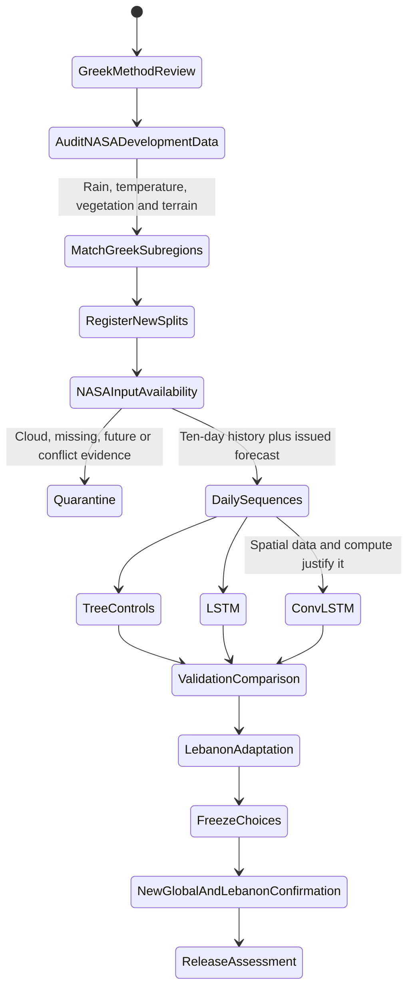

# Greek study as the main methodological reference

**Historical initial-review snapshot.** Real-data temporal training and evaluation
subsequently completed; see the [executed experiment](greek-experiment-results.md).

15 November 2026, Europe/Zurich. Status: focused source/code review and actual NASA
environmental comparison completed. **No new LSTM or ConvLSTM was trained.** The
existing global and Lebanese models, their thresholds and their rejected release
status are unchanged.

We will prioritize the Greek study's methodology while preserving the requested
global-to-Lebanon comparisons. Geographic proximity and Mediterranean seasonality
are reasons to investigate transfer, not evidence that all Greek areas are suitable
training examples for every Lebanese area.

## What the source actually does

[Kondylatos et al., 2022](https://doi.org/10.1029/2022GL099368) uses ten-day histories
for LSTM, and ten-day 25 km spatial neighborhoods for ConvLSTM. NDVI, LST, moisture,
weather and human proxies supply relevant context. Its target is large-fire danger,
using eventual burned cells of >30 ha events assigned to ignition day. Two sampled
negatives accompany each positive; negatives come from days without fires across
the study region. Later-year tests are 2020/2021. This motivates temporal models,
but its high precision does not measure our natural-prevalence occurrence task.

The [supporting information](https://pure.mpg.de/pubman/item/item_3429202_3/component/file_3429204/BGC4079s1.pdf),
Text S1, p.7, shifts historical meteorology to represent forecasts assumed available
for prediction day. It therefore does not establish an archived-issued-weather
backtest. It also forward-fills satellite composites. We must check composite end
and release times before filling values into earlier feature rows.

The reference LSTM has 64 recurrent units, with dense 32/16 units stated in the
supplement. However, the inspected
[released implementation](https://github.com/Orion-AI-Lab/wildfire_forecasting/blob/2b18bcf194284d56bd4e1774f7d5315db94cba34/wildfire_forecasting/models/modules/fire_modules.py)
uses dense sizes `hidden_size` and `hidden_size // 2`: **64/32** with its experiment
configuration. Record these as separate variants. The
[experiment config](https://github.com/Orion-AI-Lab/wildfire_forecasting/blob/2b18bcf194284d56bd4e1774f7d5315db94cba34/configs/experiment/lstm_temporal_cls.yaml)
uses one recurrent layer, dropout 0.5, Adam learning rate 0.001, weight decay 0.001,
batch size 256 and 30 epochs. No original code was imported or executed.

The [authors' repository](https://github.com/Orion-AI-Lab/wildfire_forecasting),
pinned to commit `2b18bcf194284d56bd4e1774f7d5315db94cba34`, requires at least 250 GB
to decompress its dataset and recommends a GPU. Its archive mixes NASA and other
agencies, so downloading it would not produce our authorized NASA-only dataset.

## Measured comparison of available NASA data

The reusable [regional comparison module](../src/firecast/regional_similarity.py)
compares cached POWER weather in **2018–2020 only**, with existing eligible cells,
2010 MCD12Q1 vegetation eligibility and SRTM-derived terrain. Each eligible cell
has equal weight and is assigned its nearest actual weather point; unused ocean
points do not contribute. This is descriptive development-data analysis, not a
fire-model fit. No fire labels or test metrics were read by this module.

| Development-data profile | Selected Greek panel | Eligible Lebanese grid |
|---|---:|---:|
| Eligible 0.1° cells | 326 | 124 |
| Weather points assigned to cells | 16 | 9 |
| Summer mean temperature | 25.25°C | 24.38°C |
| Winter mean temperature | 7.82°C | 7.37°C |
| Annual precipitation | 723.84 mm | 467.00 mm |
| Summer precipitation, June–August | 105.83 mm | 8.46 mm |
| Winter precipitation, December–February | 283.94 mm | 310.34 mm |
| Mean sampled cell elevation | 463 m | 945 m |



Temperature seasonality supports investigating transfer. Summer rain and terrain
show substantial differences in these sampled areas. The Greek panel is only
37–39°N, 22–24°E, not all Greece; the Lebanese domain is the eligible project grid,
not a uniform national meteorological network. Three years do not establish
long-term climate normals. POWER's coarse resolution and sampled static layers
limit mountainous-terrain interpretation.

For transparency, an exploratory four-block distance equally weights monthly
temperature, monthly precipitation, humidity, and terrain/vegetation summaries.
Scales are fitted across four candidate panels, excluding Lebanon. Distances are
Morocco 1.274, southern Turkey 1.295, Greece 1.460 and Portugal 1.995. The ranking
depends on these panels and weights; it is **not a model skill ranking**, a validated
training weight, or a reason to abandon the Greek-method focus. It argues for
within-Greece environmental matching rather than a uniform country assumption.
The [JSON](greek-lebanon-similarity.json) contains monthly profiles, component
distances, input hashes and limitations.

## Decisions for the adaptation

| Greek study component | Project decision |
|---|---|
| Ten-day temporal context | First compare explicit daily sequences with matched summary-feature trees; use only inputs available before issue time. |
| Weather, wetness and vegetation | Add NASA MODIS NDVI/LST/LAI and NASA soil-moisture proxies after QA, coverage and release-time checks. Soil moisture is not direct fuel moisture. |
| LSTM and ConvLSTM | Prioritize the smaller LSTM; introduce ConvLSTM only with coherent, genuinely spatial histories and suitable compute. A 25×25 array of repeated coarse weather is not new spatial information. |
| RF and XGBoost comparisons | Retain seasonal/logistic/RF controls and add actual XGBoost, evaluated on the same available-feature rows as neural models. |
| Selected negatives | Keep representative eligible cell-window validation/testing. Any case-control training requires explicit sampling treatment and calibration checks. |
| Eventual burned-area target | Keep our next-24-hour satellite-detected occurrence target. Any large-fire-danger experiment must have a separate target and report. |
| Regional training | Compare global, global→matched Mediterranean→Lebanon, Mediterranean→Lebanon and Lebanon-only approaches before/after adaptation on both domains. |
| Greece as a source | The current Greek panel was a geographic holdout. Do not move it into existing fits or preserve its old scores as independent generalization evidence for a new Greek-trained model. |
| Confirmation | Previously viewed 2026 data are development context, not a fresh test. Reserve an unviewed later period or prospective issued-GEOS series before another search. |
| Label exclusions | Preserve cloud/missing coverage, sensor/source review and southern-conflict quarantines. Excluded detections must never become negative examples. |

The [configuration](../configs/greek-study-focus.json) records this research design,
source commit, model settings and target differences. It is **not** a runnable
training command or a complete new frozen confirmation protocol. Data availability,
subregion selection, future split registration and compute must be resolved first.
There is about 286 MB disk free here, no GPU and no installed PyTorch environment;
the small audit runs locally without new downloads. The original 250 GB mixed-source
archive is neither necessary nor suitable for starting the NASA adaptation.

## Reproduce the completed work

From `forecasting/` with the existing locked environment and cached data:

```sh
uv run --frozen python -m firecast.regional_similarity --config configs/greek-study-focus.json --out docs/greek-lebanon-similarity.json
uv run --frozen pytest -q tests/test_regional_similarity.py
```

Notebook [09](../notebooks/09_greek_study_and_regional_similarity.ipynb) calls this
same module. Tests cover future-row isolation, complete calendars/leap years,
unassigned-point removal, duplicate/missing observations and excluding target data
from distance-scale fitting. These checks do not validate a new forecasting model.


