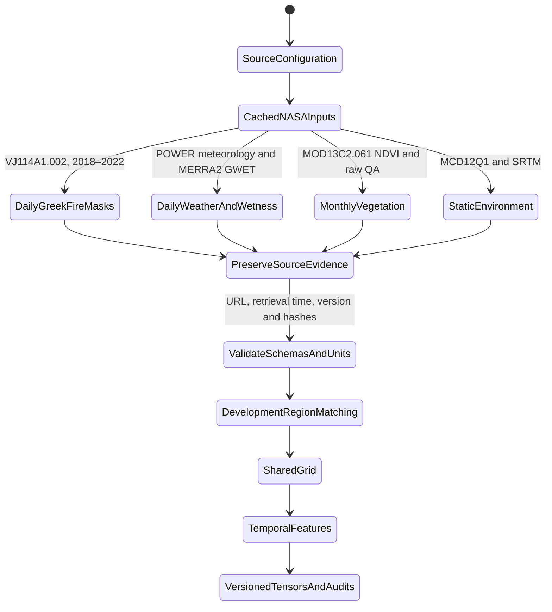
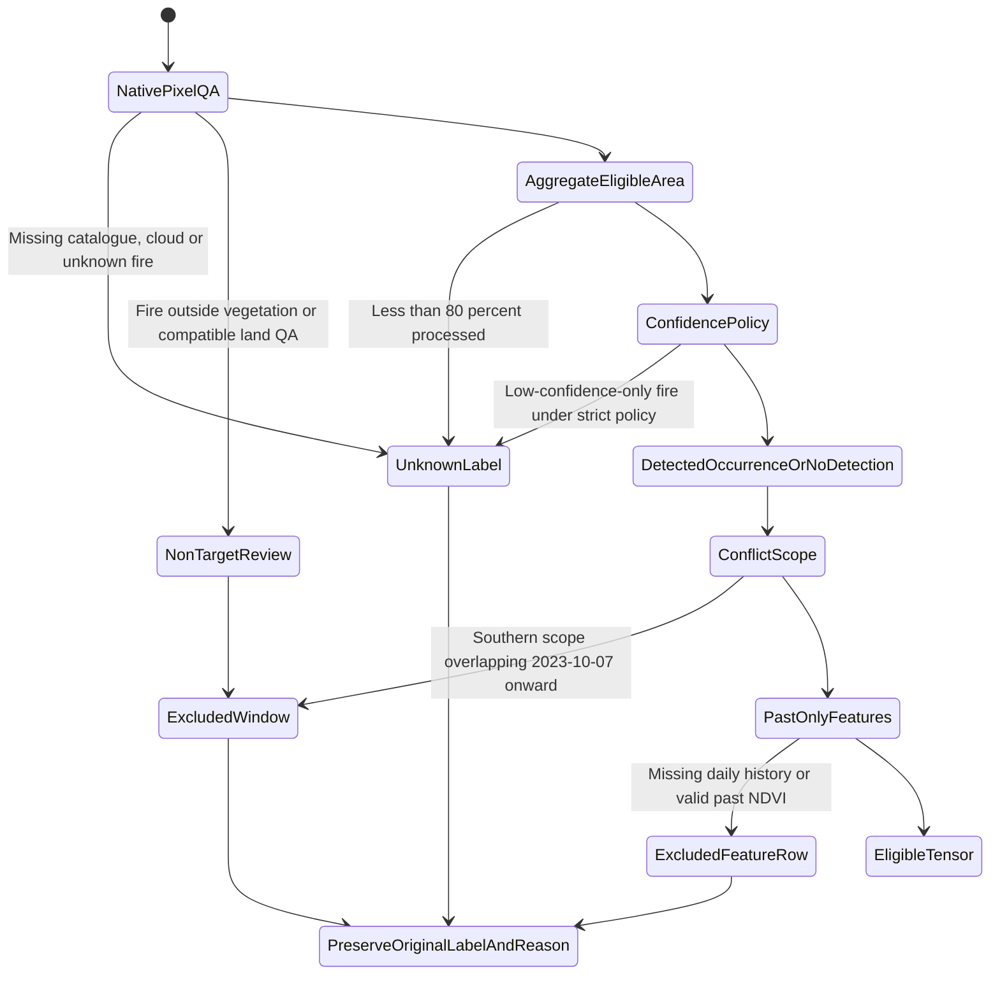
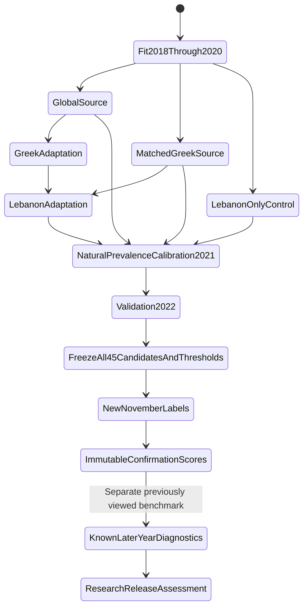
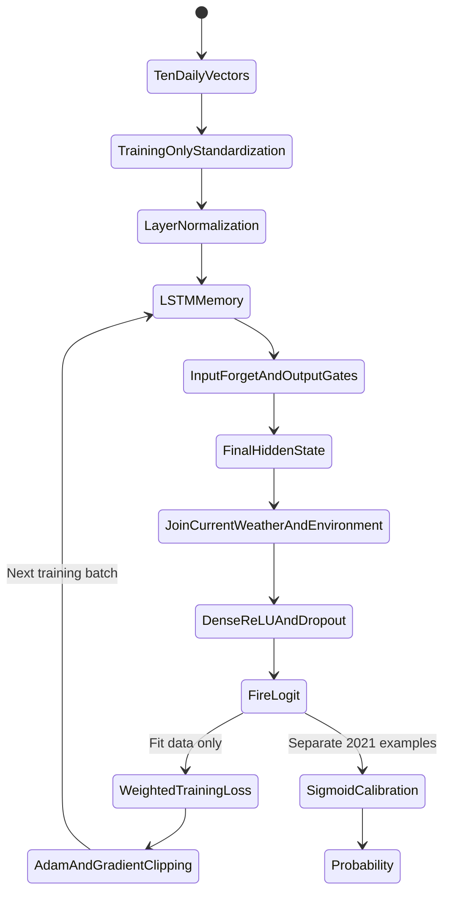
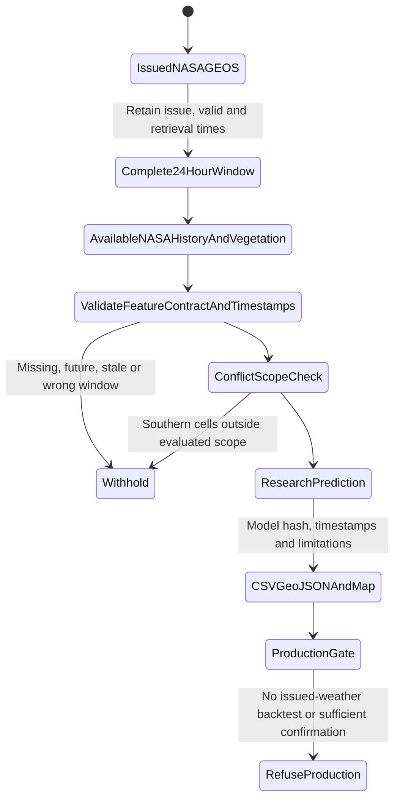

# Greek-inspired temporal pipeline statecharts

These describe the implemented research pipeline. Every production release remains
unapproved. ConvLSTM is a deferred experiment, not a trained model.

## NASA extraction, exploration, transformation and loading

The Greek training panel initially had zero positives with two sampled days/month.
Daily collection expanded all dates, not just fire days. Environment-only matching
retains 163/326 Greek cells using 2018–2020 weather/terrain; it never uses test fires.
Global fire-label dates remain sampled. Exact selected raw arrays and QA are
retained; original complete MODIS containers are transient with recorded hashes.
Older full daily fire files are losslessly packed with verified restoration.

## Labels, exclusions and feature availability

An excluded positive is never relabelled negative. MODIS CMG QA bits 14–15 encode
spatial contribution, not tiled-product snow/shadow. Reject unreliable/climatology-
filled vegetation, enforce composite completion plus a declared lag, and retain
NDVI age/missing-change indicators. Ten-day weather/wetness histories end four days
before target day. Historical target-day weather remains an explicitly retrospective
perfect-weather proxy; historical release/version availability is not proved.

## Fitting and genuine neural continuation

Fourteen-day gaps separate fitting/calibration/validation. All input scalers fit
training only. Seasonal/logistic/RF/XGBoost/LSTM32/LSTM64 models use identical
feature-qualified rows; weather-only logistic/XGBoost controls remove vegetation,
terrain and wetness inputs. Repeated search on only 32 Lebanese validation positives
is unstable. Tree/logistic adaptation adds the frozen parent score and refits local
weights; it does not continue tree weights. Neural adaptation actually continues
weights and freezes the parent's feature scalers.

## LSTM computation

Inputs include modeled root/surface wetness and historical weather. Current weather
proxies, terrain/season/location, past NDVI, age and change indicator join the final
hidden state. Class weighting changes the fitting objective; calibration does not
guarantee reliable probabilities under geographic or weather-source transfer.

## Actual forecast inputs and research inference

The optional fixed regional router keeps selected global weights outside Lebanon
and selected transfer weights inside it. It is explicit routing, not a newly fitted
global improvement. Actual future inputs demonstrate engineering only: neither that
map nor the two November dates validate operational warning performance.
