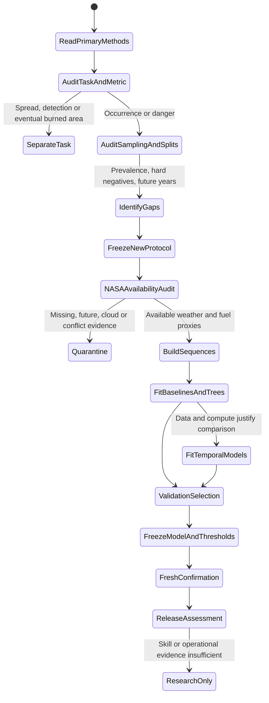

# Fire forecasting literature: what the high scores mean

Reviewed 14 November 2026 (Europe/Zurich). Primary-source methods review, not a
systematic review or a reproduced external leaderboard. No model was trained or
selected in this review. Predictor acquisition remains restricted to NASA sources.
Source papers use other agencies too; reading them does not authorize silently
adding their datasets to this project.

The published results suggest useful improvements, but the reported metrics often
describe different tasks and evaluation populations. Our weak Lebanese result
remains weak; neither protocol differences nor a larger ROC-AUC excuse it.

## A new diagnostic on our existing frozen model

The validation-selected global 128–64–32 network was re-scored without fitting,
calibrating or changing thresholds. Artifact and split hashes were checked and
the previously published average precision reproduced. See
[machine-readable output](literature-metric-context.json) and
[reproduction script](../scripts/literature_metric_context.py).

| Fixed 2026 population | Windows / positive windows | ROC-AUC | Average precision | Precision / recall at frozen threshold | Always-no-fire accuracy |
|---|---:|---:|---:|---:|---:|
| Later dates at source panels | 113,942 / 1,402 | 0.90230 | 0.16497 | 0.27029 / 0.24465 | 98.770% |
| Six held-out geographic panels | 34,407 / 604 | 0.87793 | 0.09080 | 0.22222 / 0.00662 | 98.245% |
| Lebanon, repeated fixed fold | 24,237 / 15 | 0.55173 | 0.000688 | 0 / 0 | 99.938% |

These rows concern the **global winner before Lebanese adaptation**, not the
selected transfer ensemble. They remain retrospective, coverage-conditioned
satellite-occurrence results over sampled panels, not all Earth or validated
issued-weather forecasting. The Lebanese fold is already viewed. Computing a new
metric does not create new independent evidence or permit another selection.

ROC-AUC measures ordering of positive/negative pairs. Average precision emphasizes
retrieved positives as the alert set grows and depends on prevalence. Accuracy can
be extremely high when every fire is missed. A global model with ROC-AUC around
0.90 can therefore still have poor alert precision and recall.

## Primary studies and comparison limits

### 1. McNorton et al., 2024: global Probability-of-Fire

[Paper](https://agupubs.onlinelibrary.wiley.com/doi/10.1029/2023GL107929),
especially Methods and Sections 3.1–3.2.

XGBoost predicts daily MODIS active-fire presence in roughly 9 km cells. Inputs
include weather, live/dead fuel load and moisture, LAI and land characteristics.
Training uses 2010–2014, evaluation 2015–2019; XGBoost samples roughly 300 million
land observations. Reported **ROC-AUC is 0.818**, versus 0.810 for climatology and
0.746 for RF. Evaluation removes predicted probabilities below 0.1%. This is not
81.8% accuracy or average precision. Operational IFS forecasts are also evaluated;
historical versus operational LAI differ. Useful lessons are fuel-state features,
issued-weather testing and strong climatological controls. Our differently sampled
ROC-AUC cannot establish superiority over this system.

### 2. Di Giuseppe et al., 2025: weather, fuel and ignition ablations

[Nature Communications paper](https://www.nature.com/articles/s41467-025-58097-7);
the full article was read through its
[Europe PMC full-text XML](https://www.ebi.ac.uk/europepmc/webservices/rest/PMC11962136/fullTextXML)
when publisher/PMC browser access failed.

The ECMWF study compares RF, XGBoost and neural networks with 19 predictors grouped
as weather, fuel and ignition. Fuel includes abundance and live/dead moisture;
ignition proxies include lightning, population and roads. Richer inputs improve
performance more than added architecture complexity; XGBoost is competitive with
the neural alternative. Its main summary combines multiple normalized skill scores,
so a diagram value near one must not be presented as classification accuracy.
Take the feature-group ablation idea; do not copy an operational success claim from
selected case studies or assume NASA proxies exactly reproduce its physical fuel model.

### 3. Mesogeos, NeurIPS 2023: Mediterranean temporal models

[Fixed paper v2](https://arxiv.org/html/2306.05144v2), Sections 3 and 4.1;
[author project page](https://orionlab.space.noa.gr/mesogeos/).

Thirty-day histories feed LSTM/Transformer/GTN models at 1 km. Labels represent
ignitions of fires exceeding 30 ha. Training is 2006–2019, validation 2020 and test
2021–2022. The test has 1,369 positives and 2,738 negatives: **33.3% positive**.
Negatives lie at least 62 km from that day's ignitions; loss is burned-area weighted.
Paper-v2 AUPRC is **0.853/0.856/0.858**; the website lists **0.856/0.870/0.855**.
Keep the versions separate. Rich temporal vegetation/soil information is promising,
but the selected case-control task is unlike our full eligible cell-day population.
Its softmax danger scores are not established natural-prevalence probabilities.

### 4. Kondylatos et al., 2022: Greek temporal and spatial context

[Paper](https://agupubs.onlinelibrary.wiley.com/doi/full/10.1029/2022GL099368),
Methods and Table 1.

LSTM and ConvLSTM use ten-day histories; ConvLSTM also uses 25 km spatial patches.
Vegetation, LST, moisture and human proxies supplement weather. Training covers
2009–2018, validation 2019, tests 2020/2021. ConvLSTM F1 is **0.806/0.871**.
Positives are final burned cells of fires larger than 30 ha, assigned to ignition
day; negatives are sampled from entirely fire-free days, with two negatives per
positive. Many pixels can share one incident. The authors note easier seasonal
separation of negatives in 2021. Learn from temporal context while retaining
incident grouping and natural-prevalence testing; do not confuse danger over an
eventual footprint with next-day detected occurrence.

### 5. Pourmohamad et al., 2026: very high accuracy, harder future year

[Paper](https://agupubs.onlinelibrary.wiley.com/doi/10.1029/2025EF006935),
Sections 2.2–3.3 and Table 1.

XGBoost combines incident records with 29 environmental/social/administrative
attributes. The 2000–2018 pool is split 65/15/20%; 2019/2020 are extra tests.
All-cause IM test accuracy is **99.77%**, precision **95.54%**, recall **82.96%**.
In 2020, accuracy remains **99.22%** while recall is **24.04%** and F1 **35.75%**;
augmented-model recall is **21.77%**. Their hard-negative augmentation improves
absence discrimination. This supports better negatives, not a claim that high
accuracy is entirely meaningless. They explicitly omit spatial blocking. Feature
availability, historical covariates and sampled point-versus-grid probabilities
need auditing before interpreting this as an operational 24-hour forecast.

### 6. Huot et al., 2022: next-day spread, not ignition forecasting

[Paper v2](https://arxiv.org/html/2112.02447v2), Tables II–IV.

A convolutional autoencoder predicts tomorrow's active-fire mask given today's
fire and environmental maps. At 1 km, PR-AUC is **0.284**, precision **0.336** and
recall **0.431**, versus persistence PR-AUC **0.115**. Removing today's fire mask
reduces PR-AUC to **0.068**. Coarser binary outputs raise PR-AUC to **0.663** at
8× linear aggregation. Splits randomly allocate weeks with a one-day gap, not
whole later years. The score gains partly reflect a changed target scale and known
ongoing fires. Keep a persistence baseline, but report ongoing-fire and previously
inactive-cell performance separately; do not relabel spread skill as ignition skill.

## How high scores arise

* **Genuine input improvements:** dynamic fuel abundance and moisture, antecedent
  sequences and ignition proxies. Our static vegetation fraction and a few weather
  summaries do not represent those processes completely. This is a research-supported
  hypothesis about our errors, not a measured attribution of them.
* **Different metrics:** ROC-AUC 0.90, AP 0.16 and 98% accuracy can coexist. PR-curve
  trapezoidal area and average precision can also differ; record the implementation.
* **Selected negatives:** excluding nearby or same-season challenging negatives
  changes class separation as well as prevalence. A calibration intercept can fix a
  pure sampling-prior shift only under restrictive assumptions; it cannot undo a
  changed negative distribution or missing environmental controls.
* **Different outcomes:** large-fire danger, eventual burned footprint, ongoing-fire
  persistence and smoke recognition are not equivalent to our stated target.
* **Different validation:** row/week splits can be easier than future-year and unseen-
  region tests. This does not establish leakage in a paper without further evidence.
* **Different spatial scales:** a larger cell increases event prevalence and spatial
  tolerance. Compare each scale with its own baseline and operational usefulness.

For intuition only, suppose recall stays at 80% and false-positive rate at 1%.
Precision equals `recall * prevalence / (recall * prevalence + FPR * (1-prevalence))`.
It would be **97.56%** at one positive per two negatives, **49.92%** at our global
prevalence, and **4.72%** at our Lebanese prevalence. These are hypothetical
calculations, not transferred paper scores. Geographic/label changes may change
both error rates, so no published precision can be mechanically converted to ours.

## Proposed experiments, in order

These are research decisions, **not implemented improvements or promised scores**.

1. Audit event episodes and add availability-safe persistence controls. Preserve
   the occurrence target (including continuing detections), but evaluate separately
   for cells with and without already-known fire. Only detections actually received
   before issue time may be inputs; daily final products cannot be assumed real-time.
2. Replace sparse temporal examples with contiguous daily sequences in a larger,
   biome-stratified NASA panel. Keep cloud/QA/conflict quarantines, temporal gaps and
   complete geographic/incident holdouts. Sample challenging negatives for training
   if needed; keep representative validation and test populations and sampling weights.
3. Add dynamic vegetation and moisture. NASA
   [MOD13Q1.061](https://ladsweb.modaps.eosdis.nasa.gov/missions-and-measurements/products/MOD13Q1/)
   supplies 250 m/16-day vegetation indices;
   [MCD15A3H.061](https://ladsweb.modaps.eosdis.nasa.gov/missions-and-measurements/products/MCD15A3H)
   supplies 500 m/4-day LAI/FPAR. NASA
   [SMAP SPL4SMGP](https://nsidc.org/data/spl4smgp/versions/8) supplies modeled/assimilated
   surface/root-zone soil moisture at 9 km/3 hours, not direct fuel moisture. Reject
   composites whose interval or release follows issue time. Version histories,
   mountainous-terrain QC and historical availability require checking. The
   [NASA NSIDC latency table](https://nsidc.org/data/user-resources/help-center/what-are-latencies-smap-radiometer-data-sets)
   lists SPL4SMGP mean latency about 2 days 16 hours, required latency seven days;
   this is not a guaranteed three-day delivery contract. Record actual availability.
4. Benchmark actual XGBoost (not already-tested sklearn histogram boosting under
   another name), a weather/fuel-index baseline, temporal summary trees and a modest
   LSTM/TCN on the **same features and splits**. Only then add spatial models if
   coherent image sequences and compute support them. Compare ablations using
   identical eligible rows; report the changed population if features reduce coverage.
5. Evaluate regional calibration/biome-specific heads against universal transfer.
   Our Lebanese adaptation damages global calibration; keep global and local
   inference contracts explicit. NASA-only proxies do not authorize adding EFFIS,
   ECMWF or road data from external providers without a scope change.
6. Freeze a new protocol before model development. Existing 2026 outcomes are known;
   reserve a genuinely unviewed later period or collect a prospective series of
   issued NASA GEOS forecasts and observed outcomes. Rolling historical development
   folds can estimate variability, but are not a replacement for fresh confirmation.
   Choose thresholds on validation using alert budget/cost; report AP, ROC-AUC,
   calibration, recall/precision, event counts and false alerts per area-day.

We have roughly 287 MB disk free and three CPUs in this workspace at review time.
The full new time-series program needs additional storage; this review did not
start downloads that could fill the filesystem. No new experiment should be
described as completed until its data, availability audit and measurements exist.

## Statechart: turn research into testable changes

Validation performed for this review: executed the diagnostic against the trusted
frozen global artifact; reproduced prior AP in all three domains; verified source
hashes before/after. These are reporting checks, not a rerun of the model test suite
or an external-paper reproduction.
