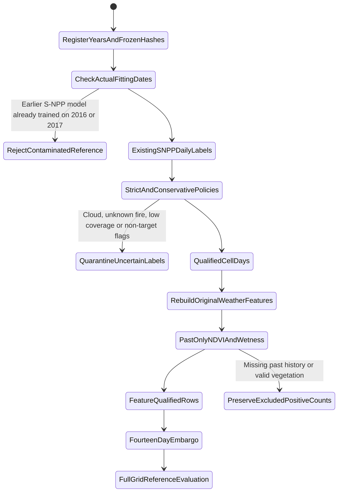
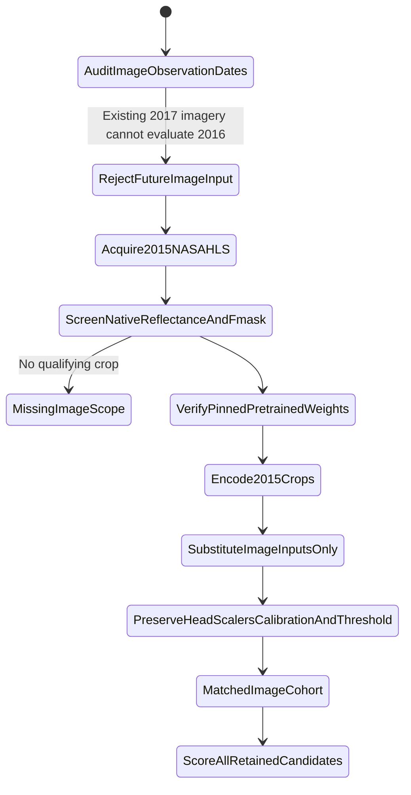
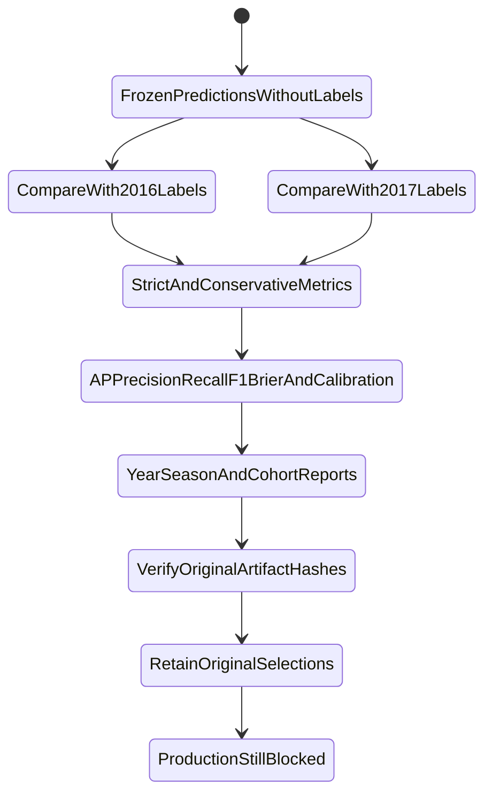

# Older-year evaluation statecharts

This evaluates frozen post-2018 models on older, cross-sensor observations. It is
not retraining, model selection or a simulation of a model deployed in 2016.

S-NPP VNP14A1.002 replaces unavailable NOAA-20 labels for these years. >=80%
processed eligible area remains conditional daily observation evidence, not proof
of continuous fire detectability. The original raw data and per-policy uncertain
labels remain intact. Southern cells are included before the 2023 conflict cutoff.
The embargo withholds 21–31 December 2017 before the earliest 5 January 2018 fit.

Input substitution uses separate model views and leaves original artifacts
unchanged. It is not fine-tuning. The 2015 and original token archives must have
identical pretrained final-normalization parameters/checkpoint identities. Weather
and environmental inputs keep their original feature definitions and units.

Modern weights, retrospective image processing and observed-weather proxies
prevent a historical operational-as-of claim. Sensor/fire prevalence and image-age
changes can affect scores. Counts describe positive cell-windows, not certified
independent incidents. Results do not select a new model or threshold.
