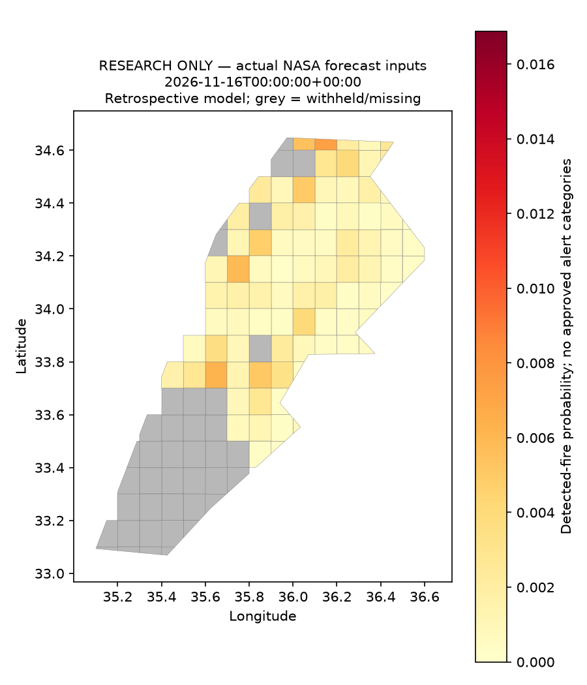

# External NASA-pretrained encoders: measured Lebanese adaptation

**Real published checkpoints and real NASA HLS images were used. Production approval remains false.**

These are three pretrained geospatial image encoders with newly trained fire-occurrence heads. They are not three previously trained wildfire forecasting systems. See [source/license review](pretrained-sources.md) and [statecharts](pretrained-statecharts.md).

NASA HLS L30 v2 supplied qualifying pre-2018 landscape crops for **115/124 cells**. Each crop samples only 960m square within a roughly 10km cell. Exact six-band crops, Fmask, coordinates, observation dates, source URLs and subset hashes are retained; full COG containers are not copied locally. Static old imagery is not current fuel condition.

The published full checkpoint bytes were downloaded into RAM, checked against pinned SHA256/size, and their entire encoder state loaded strictly. Reconstruction decoders are unused. Model receipts include source revisions, original normalization, upstream file hashes and encoder parameter counts. Cached tokens precede the original final LayerNorm; other encoder blocks are frozen.

For each checkpoint compare a frozen encoder with a head-only fit, and limited fine-tuning of the pretrained final LayerNorm plus the head. The latter actually updates pretrained scale/bias, not attention blocks. Twelve fixed epochs use Lebanese 2018–2020 data, capped positive weighting and train-only scaling. Natural-prevalence calibration uses 2021, validation/model/threshold selection uses 2022, with fourteen-day gaps. No test result changes those choices.

| Split | Kept windows | Positive windows | Missing-image excluded positives |
|---|---:|---:|---:|
| train | 102,055 | 165 | 32 |
| calibration | 33,041 | 81 | 17 |
| validation | 32,591 | 29 | 3 |
| lebanon_known_2023_2025 | 87,757 | 113 | 20 |
| lebanon_known_2026_JanOct | 22,268 | 14 | 1 |

**Validation-selected within this new comparison:** `prithvi-v2-100m-tl-frozen_encoder`. **Validation-selected external-pretrained arm:** `prithvi-v2-100m-tl-frozen_encoder`. All 10 candidates remain in the report, including seasonal, weather/environment logistic and no-image MLP controls. This does not replace the earlier project selection.

| Candidate | Validation AP | Known 2023–2025 AP | Known Jan–Oct 2026 AP | 2023–2025 precision | 2023–2025 recall |
|---|---:|---:|---:|---:|---:|
| seasonal | 0.001314 | 0.002469 | 0.000979 | 0.2591% | 75.2212% |
| weather-logistic | 0.001816 | 0.002979 | 0.002050 | 0.3508% | 16.8142% |
| environment-logistic | 0.002530 | 0.005196 | 0.003684 | 0.4956% | 51.3274% |
| no-image-mlp | 0.002720 | 0.005346 | 0.003923 | 0.4713% | 52.2124% |
| prithvi-v1-100m-frozen_encoder | 0.002850 | 0.009231 | 0.002708 | 2.4055% | 6.1947% |
| prithvi-v1-100m-final_layernorm_tuning | 0.002707 | 0.007925 | 0.002875 | 2.7972% | 3.5398% |
| prithvi-v2-tiny-tl-frozen_encoder | 0.002810 | 0.006692 | 0.002788 | 1.7123% | 8.8496% |
| prithvi-v2-tiny-tl-final_layernorm_tuning | 0.002973 | 0.006723 | 0.003041 | 1.3793% | 5.3097% |
| prithvi-v2-100m-tl-frozen_encoder | 0.002994 | 0.016956 | 0.002962 | 3.0303% | 4.4248% |
| prithvi-v2-100m-tl-final_layernorm_tuning | 0.002770 | 0.017169 | 0.002973 | 3.2864% | 6.1947% |

## Earlier frozen references on the same evaluation rows

These earlier models are unchanged and remain outside new candidate selection. Their original fitting used the full feature-qualified population before HLS exclusions, so their training populations differ from this image-qualified experiment.

| Reference | Matched validation AP | Matched known 2023–2025 AP | Matched known Jan–Oct 2026 AP |
|---|---:|---:|---:|
| lstm64-global | 0.001679 | 0.002858 | 0.002402 |
| lstm64-lebanon | 0.003072 | 0.006683 | 0.003953 |
| logistic-global_greek_lebanon | 0.002828 | 0.005316 | 0.002720 |

The selected external arm detects **5/113** positive windows with **160 false alerts** in 2023–2025. On the known 2026 fold it detects **0/14** with **33 false alerts**. Better ranking on the older cohort does not establish useful alerts or sustained transfer.

The final-LayerNorm tuning arms are retained even when they lose validation. The slightly higher 2023–2025 AP of a nonselected arm does not promote it after tests. The earlier local LSTM also has higher matched validation AP than the new selected external arm; this experiment does not justify replacing it on test results.

AP is average precision, not accuracy. Precision/recall use each candidate’s validation-fixed threshold. Full confusion matrices, Brier, ROC-AUC, reliability bins and seasonal metrics are in [JSON](pretrained-results.json); compact [CSV](pretrained-results.csv) is also available.

## Interpretation and remaining gaps

These later-year outcomes were already viewed in previous experiments. They are diagnostics, not new independent confirmation. Only 32 positive Lebanese validation windows existed before any HLS exclusions, and repeated searches make selection unstable. Current weights were unavailable in the historical prediction years; globally pretrained EO2 may have seen Lebanese imagery. HLS reprocessing dates do not prove historical availability. Thus this experiment does not satisfy a strict operational historical-as-of backtest.

Current-day historical POWER meteorology remains an observed-weather proxy, not an archived issued forecast. Cloud/QA-conditioned satellite labels miss some events. Source labels, conflict exclusions, missing-image audits and natural class imbalance remain part of interpretation. No production approval or high-precision alert claim follows from image pretraining.

The predictor accepts no fire labels during inference. It requires an exact image-qualified cell or a newly acquired/encoded compatible image; a missing image must withhold prediction. The shipped heads use cached 2017 landscape tokens, so the bundle is explicitly a bounded retrospective research artifact, not a worldwide live satellite service.

## Reproduce

Use the [README instructions](../README.md#external-pretrained-encoders) and notebook 11. Runtime uses the existing CPU torch environment plus a system GDAL Python for HLS COG reads. No timm/TerraTorch package or remote Python code execution is needed. Rebuilding tokens requires downloading roughly 1.04 GB of pinned checkpoint bytes in total; peak RAM should allow several GB. Source weights are streamed to RAM and are not retained as full checkpoint files.

## Actual NASA forecast-input example

The validation-selected pretrained arm produces 84 research estimates over 124 cells for 2026-11-16T00:00:00+00:00 through 2026-11-17T00:00:00+00:00. All 32 southern-scope cells are withheld; missing HLS/NDVI reasons can overlap. This uses the already acquired actual NASA GEOS forecast and actual antecedent inputs, without future fire labels.

HLS observation/retrieval and pretrained-weight retrieval times are retained separately; future or missing source timestamps suppress scores. The production API remains gated.
