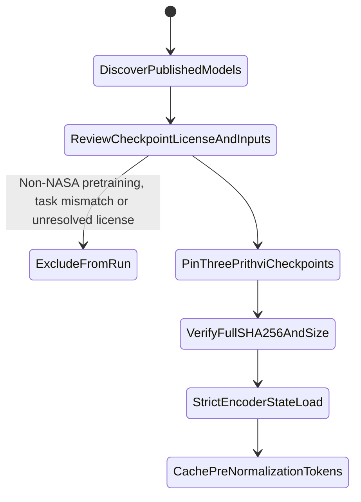
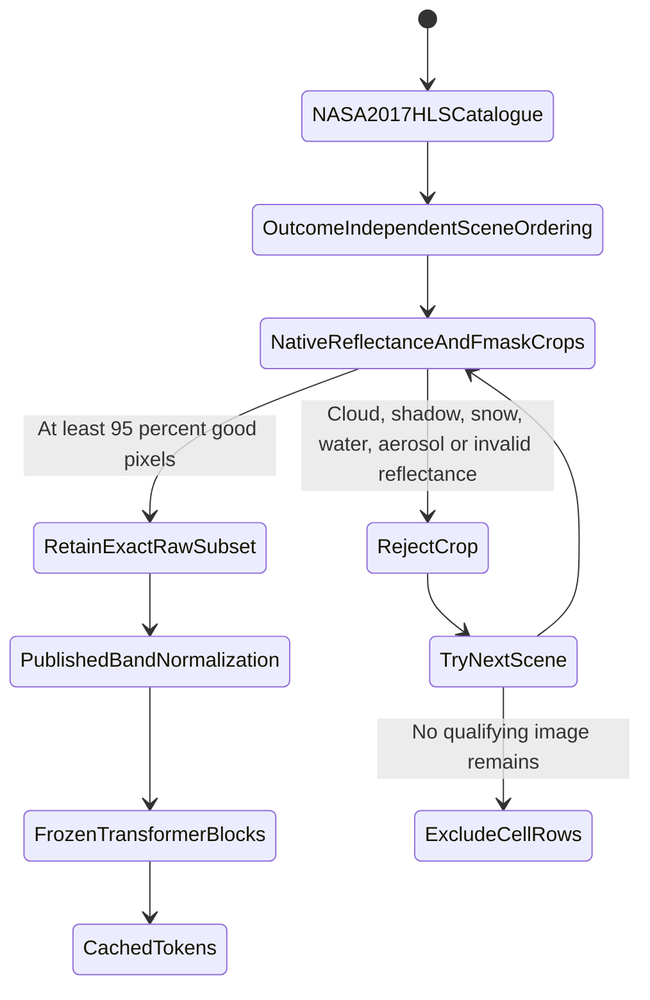
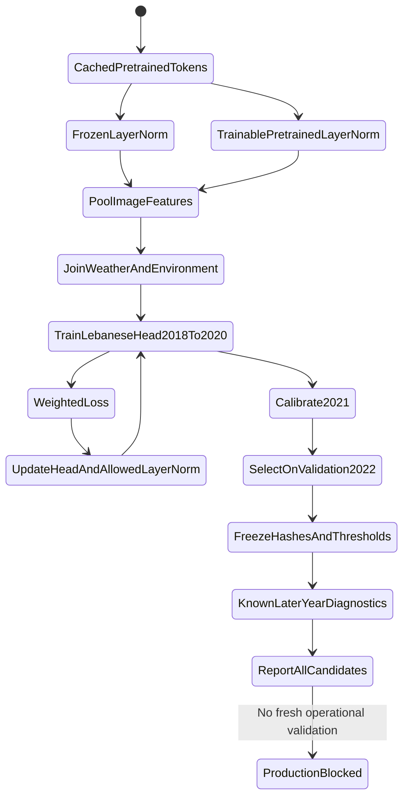
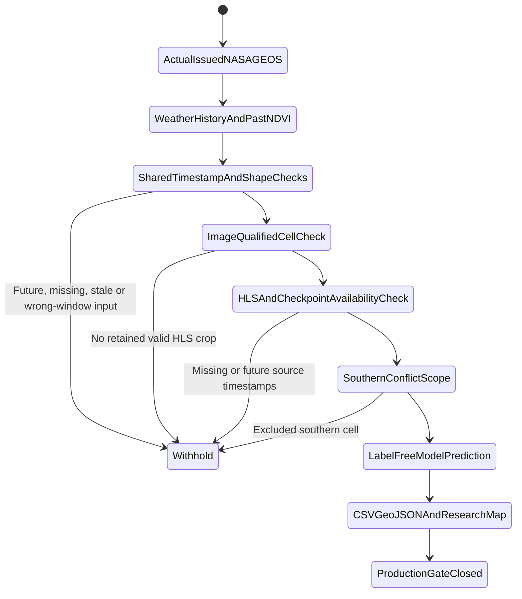

# External pretrained model adaptation

Missing-image positives remain counted in the exclusion audit. Original fire
cloud/QA uncertainty and southern conflict exclusions remain in the upstream
versioned labels. No fire outcome is used to select an HLS scene.

The seasonal, weather/environment logistic and no-image MLP controls use the same
rows and split years. Test scores never reselect weights or thresholds. These
checkpoints do not initially predict fires: their Lebanese occurrence heads must
be trained. New production inference would also need current, timestamp-verified
HLS and an issued-weather backtest; existing API approval gates remain closed.

The executed 16–17 November UTC example returns 84/124 estimates. All 32 southern
cells and missing HLS/NDVI cases are withheld, preserving overlapping reasons.
Outputs identify the selected external candidate, model hash, forecast/source
timestamps and old-landscape warning. This example does not replace the earlier
project selection or establish operational forecast performance.
