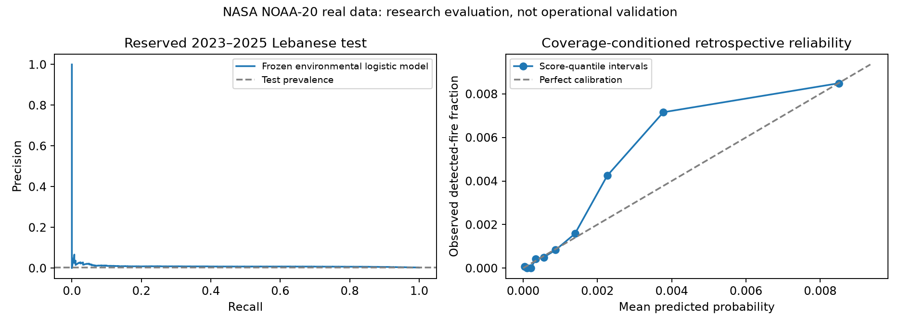
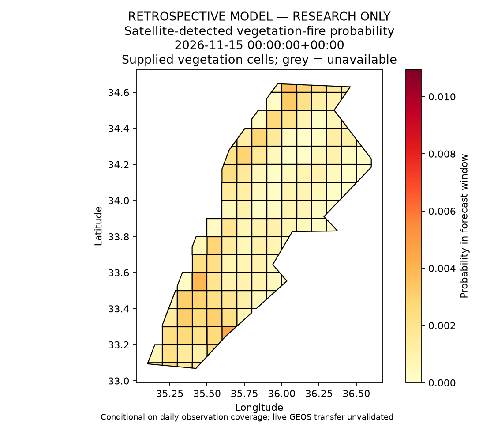

> Earlier Lebanon-only stage. The latest completed experiment is [global pretraining and Lebanon adaptation](global-results.md), including conflict exclusions and 2026 comparisons.

# Delivery report

The current report is [actual real-data results](current-results.md). Earlier fixture-only reports have been superseded.

**Real NASA training and reserved-year evaluation are complete. The current model is retrospective research only and is not approved for production.** This report supersedes the earlier fixture-only and access-blocked status snapshots. Full numerical evidence is in [NOAA-20 metrics](real-metrics.json), [S-NPP metrics](snpp-real-metrics.json), [review summary](current-results.json) and [failed release record](release.json). [Statecharts](statecharts.md) explain the entire implemented path.

## Data and task

NASA-only acquisition completed: 48 FIRMS Lebanon files / 17,946 detections, 61,368 POWER weather point-days, 20,456 SYN1DEG cloud point-days, two 2010 MCD12Q1.061 land-cover tiles, four SRTMGL1.003 elevation tiles and NASA-served country geometry. Earthdata authentication succeeded and all 15,944 catalogued daily fire-mask tiles were downloaded without reported failures: 10,119 S-NPP tiles (2012–2025) and 5,825 NOAA-20 tiles (2018–2025). Exact original source URLs, retrieval times, versions and SHA256 values are cached with the raw data. See [source ledger](sources.md).

The primary model targets NOAA-20 **VJ114A1.002 daily nominal 1km detected vegetation-associated fire**, from its VIIRS 750m-band algorithm. This is not interchangeable with FIRMS 375m detections. It estimates occurrence in 124 eligible 0.1° Lebanese cells, conditional on a daily processed eligible-area fraction of at least 0.8. Missing/cloudy/unknown observations are not automatically negative. This includes recurring/continued fire and cropland burning; it predicts neither new ignition alone, spread, damage nor transmission-line impact.

## Transformation and exclusions

The country geometry masks native pixel centres; the eligible mask contains 11,007 nominal 1km pixels. MCD12Q1 collection-6.1 QC is categorical and handled as such. Eligible pixels require sufficient valid land-cover information and vegetation fraction; cells require at least five eligible pixels. SRTM supplies elevation, metre-aware slope and circular aspect components. Weather remains coarse: the fine grid does not create local mountain weather accuracy. Static 2010 land cover is a later reprocessed product, so historical dissemination/version availability is not asserted.

Conservative filtering quarantines confirmed reviews and invalid metadata. Strict filtering also quarantines probable/uncertain source/confidence/recurrence flags and low-confidence daily fires. Recurrence candidates are frozen from training-era detections and are not labelled proven industrial sites. Every policy quarantines noneligible fire-bearing windows. Raw detections remain unchanged; excluded labels are null. Strict was declared primary before fitting; lower error across different policy populations is not evidence that one policy is more truthful.

| Policy | All cell-windows | Qualified positive | Qualified negative | Excluded | Uncertain | Positive, low coverage |
|---|---:|---:|---:|---:|---:|---:|
| Conservative | 362,328 | 809 | 320,645 | 41 | 40,830 | 3 |
| Strict | 362,328 | 612 | 319,311 | 1,609 | 40,793 | 3 |

Conservative excludes 16 fire-bearing windows; strict excludes 213. Thus strict removes an additional 1,568 windows overall, including 197 additional fire-bearing windows. These are **cell-windows, not independent fire incidents**. Neither policy is certainly clean; no complete authoritative facility/conflict/managed-burning catalogue was obtained. A provisional Beirut port FIRMS query found one nearby S-NPP detection on 4 August 2020 at 23:35 UTC; causation was not inferred and it was not automatically confirmed as an explosion-related exclusion.

## Chronological evaluation

Training, validation and test are separated by seven-day boundary gaps; target windows do not overlap across these splits. The later Lebanese test was opened after selection was frozen. Preprocessing is fitted on training data only; thresholds are validation-only. The current artifact remains the training-period fit rather than being silently refitted on test observations.

| Split | Qualified observations | Positive windows | First prediction date | Last window end |
|---|---:|---:|---|---|
| train | 117,677 | 202 | 2018-01-05 | 2020-12-24 |
| validation | 78,769 | 130 | 2021-01-08 | 2022-12-24 |
| test | 120,155 | 280 | 2023-01-08 | 2026-01-01 |

The seasonal baseline learns smoothed month frequencies. Weather logistic regression uses temperature, humidity, precipitation, wind components, lagged seven-day rainfall and seasonality; environmental logistic regression adds vegetation fraction, elevation, slope and aspect. Histogram boosting was justified by the guarded sample count and compared with the same splits. Deep learning was not justified by only 202 strict-policy training positives. No class weighting or negative subsampling was used; no calibration model was fitted. The lowest **validation Brier** within the predeclared strict policy selected environmental logistic regression. No test metric changed the choice.

| Experiment | Validation Brier | Test AP | Test Brier | Precision | Recall | F1 |
|---|---:|---:|---:|---:|---:|---:|
| conservative-lebanon-seasonal | 0.00210612 | 0.00660 | 0.00313483 | 0.0063 | 0.7316 | 0.0124 |
| conservative-lebanon-weather | 0.00210891 | 0.00664 | 0.00313800 | 0.0081 | 0.1368 | 0.0153 |
| conservative-lebanon-environment | 0.00210211 | 0.01233 | 0.00312728 | 0.0116 | 0.1342 | 0.0214 |
| conservative-lebanon-boosting | 0.00210563 | 0.00993 | 0.00314009 | 0.0192 | 0.0500 | 0.0277 |
| strict-lebanon-seasonal | 0.00164626 | 0.00410 | 0.00232185 | 0.0041 | 0.8000 | 0.0082 |
| strict-lebanon-weather | 0.00164770 | 0.00466 | 0.00232324 | 0.0064 | 0.1107 | 0.0122 |
| strict-lebanon-environment | 0.00164384 | 0.00909 | 0.00231720 | 0.0131 | 0.0964 | 0.0231 |
| strict-lebanon-boosting | 0.00165065 | 0.00752 | 0.00232815 | 0.0270 | 0.0179 | 0.0215 |

Selected model version: `strict-lebanon-environment-90b572f8ac587bab`. At the validation-F1 threshold **0.01094654**, test confusion counts **TN/FP/FN/TP = 117844 / 2031 / 253 / 27**. Precision is **1.31%**, recall **9.64%**, F1 **2.31%**. Test AP is **0.00909**, versus **0.00410** for seasonal climatology and prevalence **0.00233**. The selected AP weekly-block bootstrap 95% interval is **0.00689–0.01393**; it conditions on the fitted model and chosen labels, omitting source/label uncertainty and incident dependence. Small Brier improvement over seasonal climatology is not practical alert readiness.

Mean predicted probability is **0.001807**, versus observed fraction **0.002330**, indicating aggregate underprediction. Fixed-width and score-quantile reliability summaries are recorded. Quantile intervals preserve tied scores; calibration has not been repaired using test observations. At threshold 0.5 the model predicts no positive windows. Season, sensor, region and flag subgroup results are in the full metrics. Region is Lebanon only, and sensor groups describe the selected target product, not a multi-sensor performance claim. Independent incident counts and buffered geographic generalization have not been established.

The separate S-NPP benchmark also selected environmental logistic regression by validation Brier; strict test AP is 0.00827 on 117,756 windows / 225 positives. Its boosting model had higher test AP but was not retroactively selected. This is a historical benchmark, not a substitute for validating the current NOAA-20 product.

## Actual future-window inference

A genuine NASA GEOS forecast issued **2026-11-14 00 UTC** was downloaded as 72 regional subsets covering **2026-11-15 00 UTC to 2026-11-16 00 UTC**. All hourly meteorology, precipitation and cloud intervals were decoded with units, issue/valid times and actual retrieval timestamps. The antecedent rainfall ends three days before prediction and is rejected if incomplete or not yet available. All 124 cells produced CSV/GeoJSON/PNG research outputs; probability range is approximately 0.000053–0.004452. These values were not validated against future outcomes.

Every row carries `outside_validated_weather_source`, `RETROSPECTIVE_MODEL_NOT_OPERATIONALLY_VALIDATED` and `COVERAGE_CONDITIONAL_RESEARCH_ESTIMATE`. Historical training used observed POWER weather; one genuine future forecast does not supply an issued-forecast backtest or validate POWER-to-GEOS transfer. Future observation coverage is also unknown, so the conditional output must not be presented as unconditional operational risk. Polygons are country-clipped and map colours use an explicitly displayed probability scale. The optional supplied-asset overlay is approximate exposure screening only.

## Release status and remaining work

The real release assessment records **approved: false**. Failed checks: operational forecast mode, historical feature availability, issued-forecast backtest, independent incident separation review and acceptable calibration review. The current public GEOS archive is rolling; required multi-year issued meteorology history was not obtained. Historical GEOS-CF samples inspected did not provide the required meteorology. No analysis/reanalysis was relabelled as a forecast.

Before operational release: obtain or prospectively collect sufficient NASA issued forecasts and dissemination evidence; build matching operational-weather datasets; address observation-selection calibration; establish independent incident validation and separation; demonstrate useful held-out precision/recall/calibration for a defined decision cost; review current sensor availability; and validate drift/availability behavior. The already-viewed 2023–2025 test can be retained as a historical benchmark, but new model development requires fresh locked validation/confirmation data rather than treating that test as untouched again.

Other uncompleted scope is explicit: comparable-region training and ecological transfer assessment, buffered geographic holdout, full historical NDVI/fuel-moisture series, burned-area/ground incident validation, authoritative causal facility/conflict exclusions and a real infrastructure layer. These were not fabricated or used as pretexts to claim a better model. NASA-only access limits third-party event adjudication. A broader/global model would not repair the present evaluation gaps and is deferred.

## Reproduction and verification

Use the commands in [README](../README.md), the locked Python environment, and the raw/cache manifests. Notebook 06 executed actual static transformation, label checks, frozen-model review, failed release and genuine forecast inference; notebooks 01–03 are a separate executed synthetic example. Full metrics preserve parameters, seed 42, library versions, fitted source/code hashes and split counts. `review/split-manifest.csv.gz` records every qualified split identity. The code hash in training metrics identifies the code at fitting time; subsequent reporting/plotting and adapter guard corrections are documented in decisions.md and do not represent a new performance-selected fit.

The final focused suite passed **49 tests** (one Starlette test-client deprecation warning). Checks cover time alignment, future inputs, source QA, cell joins, cloud/label uncertainty, exclusion precedence, split gaps, release rejection, service authentication, wrong-domain withholding, redirect credential stripping and clipped MultiPolygon overlay handling. Python compilation, notebook validation and whitespace checks were also run. Container results are recorded in [production status](production-status.json). GitHub CI has not run remotely. The existing web/backend application was not changed or retested. This validation report precedes branch publication; nothing has been merged or externally deployed.
