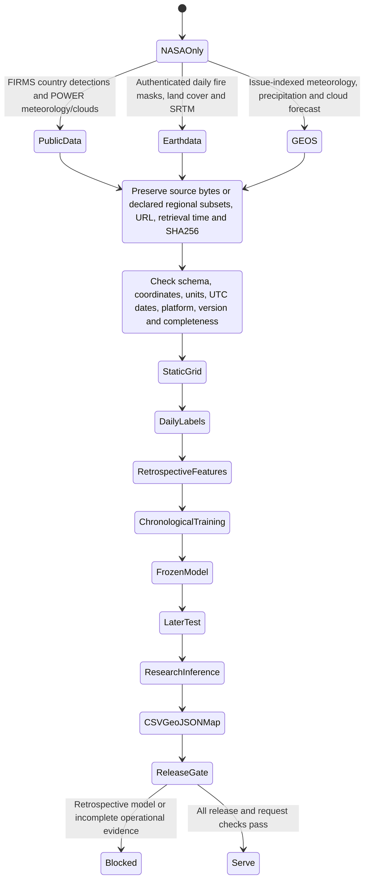

# Forecasting statecharts and current run status

Real dataset: **VJ114A1.002 daily 1km; not FIRMS 375m**; **124** eligible cells; **5,825** decoded daily tiles. Real retrospective models are fitted; production release remains blocked. See [current results](current-results.md).

* conservative: 362,328 windows; label statuses `{'negative': 320645, 'uncertain': 40830, 'positive': 809, 'excluded': 41, 'positive_low_coverage': 3}`.
* strict: 362,328 windows; label statuses `{'negative': 319311, 'uncertain': 40793, 'excluded': 1609, 'positive': 612, 'positive_low_coverage': 3}`.

## Acquisition and complete forecasting pipeline



## Geography, vegetation and terrain cleaning

```mermaid
stateDiagram-v2
    [*] --> NASACountryGeometry
    NASACountryGeometry --> SinusoidalPixels
    SinusoidalPixels: Locate native pixel centres for both source tiles
    SinusoidalPixels --> CountryMask
    CountryMask --> LandCoverQA
    LandCoverQA: MCD12Q1 collection 6.1 categorical QC; accept exact categories 0 and 2
    LandCoverQA --> VegetationMask
    VegetationMask: IGBP vegetation classes 1 through 12 and 14; cropland included
    VegetationMask --> EligiblePixel
    EligiblePixel: At least 75 percent known cover and 25 percent vegetation per nominal 1km pixel
    EligiblePixel --> GridCells
    GridCells: Require at least five eligible pixels in each configured 0.1 degree cell
    GridCells --> Terrain
    Terrain: SRTM valid elevations, metre-aware gradients, slope and circular aspect components
    Terrain --> StaticFeatures
    StaticFeatures: Fixed 2010 land cover; reprocessed version limits historical availability claims
    StaticFeatures --> RepresentativePoint
    RepresentativePoint: Use an actual eligible in-country pixel; retain nominal grid centre separately
    RepresentativePoint --> ClippedOutput
    ClippedOutput: Clip output polygons to the NASA analysis geometry
```



## Cloud handling and daily labels

The primary target is **NOAA-20 VJ114A1.002 daily 1km detected fire**, derived
from the VIIRS 750m-band algorithm. S-NPP VNP14A1 is a separate benchmark.
Neither is interchangeable with FIRMS 375m detections. Daily clear-area evidence
cannot establish continuous observation or absence of every real fire.

```mermaid
stateDiagram-v2
    [*] --> DailyMaskQA
    DailyMaskQA: Decode missing, cloud, clear land, unknown fire and confidence classes
    DailyMaskQA --> ProcessedFraction
    ProcessedFraction: Processed eligible pixels divided by fixed eligible-area pixel count
    ProcessedFraction --> PolicyExclusion
    state PolicyExclusion <<choice>>
    PolicyExclusion --> Excluded: External quarantine, noneligible fire, or strict low-confidence fire
    PolicyExclusion --> Coverage: Otherwise
    state Coverage <<choice>>
    Coverage --> Qualified: Fraction at least 0.8 and no unknown-fire pixels
    Coverage --> LowCoveragePositive: Fire detected but coverage fails
    Coverage --> Uncertain: No fire and coverage fails or source missing
    Qualified --> Positive: Eligible fire detected
    Qualified --> Negative: No eligible fire detected
    Positive: y equals 1
    Negative: y equals 0 for detected occurrence only
    Excluded: y is null; retain audit; never convert to zero
    LowCoveragePositive: Known detection retained with null fitting label
    Uncertain: y is null; never fit as a negative
```



## Detection review and alternative filtering policies

```mermaid
stateDiagram-v2
    [*] --> PreserveFIRMS
    PreserveFIRMS --> ValidateMetadata
    ValidateMetadata: Keep original sensor, confidence, source type and processing version
    ValidateMetadata --> SourceFlags
    SourceFlags: Static source, volcano or offshore source type produces probable review flag
    SourceFlags --> ConfidenceFlags
    ConfidenceFlags: MODIS percent and VIIRS categorical confidence handled separately
    ConfidenceFlags --> ExternalReview
    ExternalReview: Supplied reason, source and confidence; historical label quality only
    ExternalReview --> Recurrence
    Recurrence: Fit recurring-location candidates using training-era records only
    Recurrence --> CombineReasons
    CombineReasons: Retain every reason; recurrence is not proof of industry
    CombineReasons --> Conservative
    CombineReasons --> Strict
    Conservative: Quarantine confirmed review and invalid metadata
    Strict: Also quarantine probable and uncertain flags and low-confidence daily fires
    Conservative --> CellWindow
    Strict --> CellWindow
    CellWindow: Quarantine the whole affected cell-window, preserving raw records
    CellWindow --> Audit
    Audit: Export flag confidence, reasons, provenance and policy action
    note right of ExternalReview
        Beirut port query found one nearby S-NPP detection.
        Association does not establish explosion attribution.
        No authoritative causal event adjudication was invented.
        Unflagged does not mean certainly clean.
    end note
```



## Weather features, real forecasts and availability

```mermaid
stateDiagram-v2
    [*] --> WeatherMode
    state WeatherMode <<choice>>
    WeatherMode --> POWERHistory: Training reconstruction
    POWERHistory: Observed target-day weather; explicitly retrospective
    POWERHistory --> ResearchFeatures
    WeatherMode --> GEOSCycle: Actual future-window input
    GEOSCycle --> Decode
    Decode: Kelvin to Celsius, specific to relative humidity, vector wind, rain rate to mm
    Decode --> CompleteHours
    CompleteHours: Require every hourly interval, identical issue cycle and physical units
    CompleteHours --> AsOfCheck
    AsOfCheck: Issue and actual retrieval must precede prediction; verify exact valid window
    AsOfCheck --> LiveFeatures
    [*] --> RainHistory
    RainHistory: Seven complete prior days ending three days before prediction
    RainHistory --> HistoryAvailability
    HistoryAvailability: Reject missing values and history not yet retrieved; no zero filling
    HistoryAvailability --> ResearchFeatures
    HistoryAvailability --> LiveFeatures
    [*] --> CloudContext
    CloudContext: POWER SYN1DEG daily cloud history and GEOS future cloud fraction
    CloudContext --> ContextOnly
    ContextOnly: Coarse context; never authorize negatives from a daily average
    [*] --> MatchedSwathSample
    MatchedSwathSample: Pair real VNP14IMG mask and VNP03IMG geolocation by acquisition and shape
    MatchedSwathSample --> PixelEvidence
    PixelEvidence: Count sampled cloud and land classes; sample is not a historical coverage archive
    LiveFeatures --> SourceTransferFlag
    SourceTransferFlag: GEOS inference differs from POWER training; operational validation absent
```



## Training and algorithm logic

Strict filtering was declared primary before fitting. Conservative results are a
sensitivity analysis on a different eligible population. No negative subsampling
or class weighting was used. Deep learning was not justified by the small number
of positive windows. Comparable-region training remains unperformed.

```mermaid
stateDiagram-v2
    [*] --> RealDataset
    RealDataset --> Split
    Split: NOAA-20 train 2018 to 2020; validation 2021 to 2022; test 2023 to 2025
    Split --> Embargo
    Embargo: Seven-day boundary gaps; windows never overlap across temporal splits
    Embargo --> FitTrainingOnly
    FitTrainingOnly --> Seasonal
    Seasonal: Monthly climatology with Beta 1,1 smoothing
    Seasonal --> WeatherLogistic
    WeatherLogistic: Fit training scaler and linear weather plus seasonal score
    WeatherLogistic --> EnvironmentLogistic
    EnvironmentLogistic: Add vegetation fraction, elevation, slope and aspect components
    EnvironmentLogistic --> TreeGate
    state TreeGate <<choice>>
    TreeGate --> Boosting: At least 10000 training rows and 200 positives
    TreeGate --> Validation: Otherwise
    Boosting: Histogram gradient boosting; 100 iterations, 15 leaves, L2 equal 2
    Boosting --> Validation
    Validation: Choose lowest validation Brier within each policy
    Validation --> Threshold
    Threshold: Choose F1 threshold on validation only
    Threshold --> Freeze
    Freeze: Select predeclared strict-policy winner; save model, seed, parameters and source hashes
    note right of WeatherLogistic
        Standardize each feature using training data.
        z equals intercept plus weighted features.
        p equals 1 divided by 1 plus exp of negative z.
        Scaling and coefficients never fit on test years.
    end note
```



## Reserved-year evaluation and calibration

```mermaid
stateDiagram-v2
    [*] --> FrozenChoice
    FrozenChoice --> OpenLaterTest
    OpenLaterTest: Predict held-out 2023 to 2025; never refit or tune thresholds
    OpenLaterTest --> DetectionMetrics
    DetectionMetrics: Average precision, precision, recall, F1 and confusion counts
    DetectionMetrics --> ProbabilityMetrics
    ProbabilityMetrics: Brier, reliability bins and mean prediction versus observed prevalence
    ProbabilityMetrics --> Subgroups
    Subgroups: Season, country, sensor and review-flag groups
    Subgroups --> Uncertainty
    Uncertainty: 100 weekly-block bootstrap samples; not independent-incident uncertainty
    Uncertainty --> ComparePolicies
    ComparePolicies: Report removed windows and target-positive windows under both policies
    ComparePolicies --> Limitations
    Limitations: Fire windows are not incident counts; spatial dependence and missed fires remain
    Limitations --> ResearchReport
    ResearchReport: Low precision and weak skill prohibit an operational reliability claim
```

## Inference, maps and optional infrastructure screening

```mermaid
stateDiagram-v2
    [*] --> Request
    Request: Location or eligible grid, prediction time, issued forecast and feature timestamps
    Request --> ContractChecks
    ContractChecks --> Withhold: Missing, future, wrong-window or invalid coordinates
    ContractChecks --> DomainChecks: Contract passes
    DomainChecks --> Withhold: Wrong observation product or outside country
    DomainChecks --> ResearchProbability: Research mode permits explicit source-transfer warnings
    DomainChecks --> Withhold: Production strict mode rejects any unvalidated domain flag
    ResearchProbability --> AddMetadata
    AddMetadata: Model version, target product, window, timestamps, scope and warnings
    AddMetadata --> CSVGeoJSONPNG
    CSVGeoJSONPNG --> OptionalAssetOverlay
    OptionalAssetOverlay: Supplied point or line assets near thresholded cells; approximate bbox screening
    OptionalAssetOverlay --> ExposureOnly
    ExposureOnly: No spread, damage or probability of reaching an asset is predicted
```



## Release and service behavior

```mermaid
stateDiagram-v2
    [*] --> ReleaseEvidence
    ReleaseEvidence: Real data, current sensor, coverage, historical availability and issued-forecast backtest
    ReleaseEvidence --> EvaluationChecks
    EvaluationChecks: Test size and duration, baseline skill, incident separation and calibration review
    EvaluationChecks --> Decision
    state Decision <<choice>>
    Decision --> Blocked: Any required evidence fails
    Decision --> ApprovedManifest: All checks pass
    Blocked: Current model state; no production approval
    ApprovedManifest --> VerifyTrustedModel
    VerifyTrustedModel: Verify artifact hash, approved domain and operational mode
    VerifyTrustedModel --> NotReady: Synthetic, retrospective or mismatched artifact
    VerifyTrustedModel --> Ready: Operational artifact verified
    NotReady: Readiness and forecasting return HTTP 503
    Ready --> Authenticate
    Authenticate --> Reject: Missing or invalid API key
    Authenticate --> ValidateRequest: Valid API key
    ValidateRequest --> Withhold: Input contract or validated-domain failure
    ValidateRequest --> Serve
    Serve: Return probability, provenance, flags and request ID
    note right of NotReady
        Liveness may return HTTP 200.
        Running software does not establish model readiness.
    end note
```


